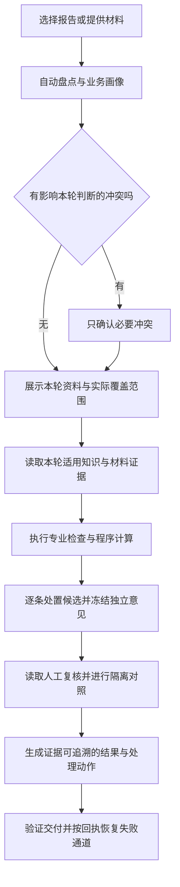

# 项目流程与审核质量优化评估

> 评估日期：2026-10-16（Asia/Shanghai）。本文是当前工作区的历史评估快照，不是现行操作规程或已批准的实施方案。
> 范围：报告审核、本地审核、报告估值、材料读取、知识适用、交付校验和质量门禁。
> 方法：读取源码及契约、执行合成数据探针与已有测试、查阅 GitHub 项目及作者文档。工作区已有大量未提交修改，本轮以实际文件为准，没有修改业务源码或既有变更。

## 1. 判断与建议顺序

项目已经具备良好的基础：员工身份边界、多轴路由、实时知识获取、两阶段独立审核、隐藏区隔离、结构化工具、同源 HTML/JSON 交付。应沿这些边界继续建设。

最值得投入的是把审核契约落实成程序能验证的事实，并用业务案例衡量每次变化的效果。员工体验也应围绕这些事实呈现：审到了哪里、结论来自哪里、尚不能确认什么、下一步怎么处理。

建议依次推进：

1. **材料读全、证据可信**：修复 PDF 可读性判断和旧版 Word 平台缺口；补齐来源、计算、冻结与证据位置的验证。
2. **业务覆盖明确、质量可测**：把已实现能力与适用业务分开呈现，建立独立标注的案例回归集。
3. **员工少操作、失败可恢复**：按任务提供明确的下一步动作，在现有会话交接上增加必要的业务回执。
4. **依据数据优化耗时**：记录各阶段耗时、等待原因和恢复成本，再优化重复取数与装配。

以上是建议优先级，不代表已经实施，也没有现有真实案例准确率或性能基线可用于承诺改善幅度。

## 2. 当前流程与应保留的设计

| 环节 | 当前基础 | 优化着力点 |
| --- | --- | --- |
| 接入材料 | 氚云精确记录快照、单附件下载；本地文件快照；估值输入冻结 | 在审核前显式说明实际可读范围 |
| 识别业务 | 范围、资产、业务、方法、监管叠加轴求并集 | 给每项分类保留证据，展示实际执行能力 |
| 获取知识 | 本轮实时导出，清单限定下载范围 | 规则适用性、正文版本和执行结果相互绑定 |
| 专业审核 | 专业 Skill 分工、公共检查、候选汇总与输出过滤 | 候选意见逐条保留最终去向及理由 |
| 两阶段对照 | 独立意见先冻结，再读取人工复核 | 由可信运行边界验证冻结与材料访问顺序 |
| 交付 | AuditResult 校验、HTML/JSON 同源、分通道发布 | 将结构校验接到事实与计算回执上 |
| 员工操作 | 报告列表、本地交接、估值父会话交接 | 入口一致、动作清楚，并保留各模式的数据边界 |

估值侧已存在可复用思路：知识正文指纹、方法能力清单、候选逐条评估、项目恢复与交付事实校验。优化审核链路时应先提炼这些机制，避免建设另一套概念相同的基础设施。审核与估值的业务判断、知识和产物契约仍应分别维护。

## 3. 本轮确认的缺口

### F1：交付校验尚不能证明来源、数值和证据位置真实

证据入口：[交付校验](../../plugins/dsh-crwu-workbench/skills/crwu/crwu-audit/scripts/audit_delivery.py#L621)、[阶段一指纹校验](../../plugins/dsh-crwu-workbench/skills/crwu/crwu-audit/scripts/audit_delivery.py#L640)、[专业轨迹校验](../../plugins/dsh-crwu-workbench/skills/crwu/crwu-audit/scripts/audit_delivery.py#L1160)、[交付 Schema](../../plugins/dsh-crwu-workbench/skills/crwu/crwu-audit/scripts/audit_result.schema.json)。

在内存中复制仓库提供的 `audit-result.sample.json`，逐项改变一个条件，调用生产函数 `validate()`：

| 探针 | 实际结果 |
| --- | --- |
| 原始示例 | 0 项校验错误 |
| 所有 issue 均不带 `sourceSkills` / `source_skills` | 0 项校验错误 |
| 将阶段一指纹替换为 64 个零 | 0 项校验错误 |
| 保留 1,234.00、1,244.00，将差额 10.00 改为 999.00 | 0 项校验错误 |
| 将证据位置改成“不存在的工作表!ZZ999999” | 0 项校验错误 |

这说明当前验证器以结构、必填信息和统计一致性为主。示例本身也未提供 issue 来源字段；非空文本、合法摘要格式不能替代来源验证。上述探针不等于证明生产中已经出现这些错误，也不等于整个系统的访问控制失效。

**建议**：

- 原始材料盘点生成稳定的 `evidenceId`；问题引用它，由程序回填文件、版本、页码或单元格。能机械验证的位置必须回读，验证不了的明确登记。
- 规则引用绑定本轮已下载正文的摘要和实际位置；适用性判断再引用相应规则，不只填一段说明文字。
- 数值结论引用计算回执：输入位置与数值、单位、运算、精度、结果、执行器版本、材料摘要。正文数字由回执生成或与回执比对。
- 原始候选保留稳定 ID；每条候选都必须有保留、合并、否决、转人工或未核等去向。合并后的来源由原始候选派生，降级和量化变化留理由。
- 阶段一冻结应由可信执行边界重算文件摘要并保存回执，阶段二访问校验该回执。摘要验证只能证明对应内容一致；访问顺序仍须由权限与阶段状态共同保证。

**验收**：上述四类异常不再无条件通过完整交付门禁；真实计算与证据位置可回读；候选无静默丢失；冻结内容变化后不能以原回执进入阶段二。

### F2：无文本的多页 PDF 会被判断为可读

证据入口：[PDF 提取](../../plugins/dsh-crwu-workbench/skills/crwu/crwu-audit/scripts/prepare_materials.py#L397)、[盘点可读性赋值](../../plugins/dsh-crwu-workbench/skills/crwu/crwu-audit/scripts/prepare_materials.py#L982)。

`pdf_to_text()` 给每页加入页码分隔文字，再按拼接后总长度是否小于 50 判断“无文本层”。本轮用 `pypdf` 生成 10 页无文本 PDF：

```text
actual_text_chars = 0
output_chars_including_page_markers = 200
error = None
classified_readable = True
```

页码标记被计入真实文本。混合文本页和扫描页也需要逐页记录，仅用全文长度无法表达实际覆盖范围。

**建议**：先统计各页真实抽取文本，再附展示标记；将文本提取、图像判读和未核页分别登记。无文本页进入渲染与多模态读取通道，只有真正判读后才能记为已核。渲染能力缺失时给出页码、影响和员工可执行动作。

**验收**：覆盖单页、多页无文本、混合文本/扫描、表格与印章页；无文本页不会因页码标记变成可读；任一页未核都能在结果中追踪。

### F3：审核材料的旧版 Word 读取仍依赖 macOS 专有工具

证据入口：[旧版 Word 提取](../../plugins/dsh-crwu-workbench/skills/crwu/crwu-audit/scripts/prepare_materials.py#L360)。

`doc_to_text()` 直接调用 `textutil`；该函数没有平台能力探测或 Windows 替代通道。模拟命令不存在时，实际抛出 `FileNotFoundError`，尝试的命令只有 `textutil`。这是对缺失工具分支的模拟，本轮没有在 Windows 真机执行。

**建议**：按仓库平台映射先探测能力；macOS 使用已探测可用的转换器，Windows 使用 DSH LibreOffice Kit 或内置只读解析。失败区分工具不存在、执行失败和探测失败；整类能力缺失时停止重复调用，并将相应文件列为“未核”。无法恢复时明确请员工另存为 DOCX/PDF 后补充。

**验收**：macOS 与 Windows 分别验证正常文档、损坏容器、工具缺失与执行失败；禁止把不可读记为材料缺失。未完成双端验证时只声明实际验证的平台。

### F4：业务适用范围与完整执行能力需要一起呈现

证据入口：[审核路由注册表](../../plugins/dsh-crwu-workbench/skills/crwu/crwu-audit/references/07-skill-registry.md#L1)、[估值方法能力](../../plugins/dsh-crwu-workbench/src/host/domains/report-evaluation/project/coverage.ts#L1)、[估值入口方法选择](../../plugins/dsh-crwu-workbench/src/client/modules/report-evaluation/model/valuation-state.ts#L90)。

审核注册表中的方法轴、监管叠加轴仍有 `pending`。这不表示相关内容完全无人检查，资产叶子或公共能力可能覆盖其中一部分；必须看实际 RULE/CHK 执行记录。估值入口允许选择市场法、收益法和成本法，而当前源码默认完整执行方法为市场法，其他方法依赖能力装配结果。

**建议**：为每轮生成业务覆盖说明，区分“业务适用”“部署具备能力”“本轮真正执行”。按检查点展示已核、未核、待人工确认、不适用及原因。方法可以保留开放选择，交接时明确实际能力缺口和后续动作。

业务画像沿用现有五轴，并关联用途、价值类型、权益边界和日期等事实。日期适用方式由相应规则决定，不把所有规则的适用日期一律等同评估基准日。未知或冲突仅挂起受影响检查点。

**验收**：每个命中轴都有实际检查点或显式缺口；员工能区分完整检查、部分检查和不适用；知识或能力补齐后可验证地改变覆盖结果。

### F5：工程测试门禁与业务准确率评测之间有缺口

证据入口：[根门禁](../../Makefile#L121)、[CI](../../.github/workflows/ci.yml#L19)、[路由契约测试](../../plugins/dsh-crwu-workbench/skills/crwu/crwu-audit/scripts/test_audit_multiaxis_router.py#L1)。

本轮运行的交付测试 115 项、材料准备测试 35 项全部通过，上述探针仍能复现。现有测试有价值，但通过测试不能说明专业判断准确。

在检查的 Makefile、CI、npm scripts、插件脚本和测试中，未找到对 `test_audit_delivery.py`、`test_prepare_materials.py` 的测试执行接线；也未发现专门的、独立标注的审核质量评测集。当前插件 CI 的 OS 矩阵是 Linux/Windows，未包含 macOS；审核 Python 技能门禁只在 Linux 步骤运行。

**建议**：先把已有审核脚本测试接入门禁，并增加本轮复现问题的回归断言；再建立业务评测集。业务评测不复用模型自报分数作为正确答案，也不把人工复核原文传给独立审核阶段。

**验收**：相关生产函数被故意破坏时门禁必红；评测能分别发现误报、漏报、证据错误、覆盖不足和恢复失败；跨平台能力有对应平台的执行证据。

### F6：不同入口的交接与恢复体验可以更清楚

证据入口：[审核运行状态](../../plugins/dsh-crwu-workbench/src/host/domains/report-audit/state.ts#L1)、[本地一次性交接](../../plugins/dsh-crwu-workbench/src/host/domains/local-audit/handoff.ts#L1)、[估值入口状态](../../plugins/dsh-crwu-workbench/src/client/modules/report-evaluation/model/valuation-state.ts#L20)、[估值恢复](../../plugins/dsh-crwu-workbench/src/host/domains/report-evaluation/lifecycle/resume.ts#L1)。

当前报告审核跟踪子会话，本地审核为进程内一次性交接，估值入口在交接后不再请求运行状态。这些是明确的产品选择，不能简单当作缺陷。但员工仍需要知道交接是否成功、结果在哪里、失败后点什么。

**建议**：在现有交接回执上提供统一用语和动作：打开当前会话、查看资料范围、查看交付件、处理缺口、恢复本轮。估值保留原生父会话承载执行；已有恢复机制继续复用。本地模式维持一次性、不自动保存历史和不自动上传的边界，提示词失效时直接说明如何重新交接。

**验收**：员工无需知道 Skill、schema code 或工具名即可继续任务；重启、网络失败、登录失效时动作清楚；恢复不会误开重复任务或访问其他案例。

## 4. GitHub 上值得借鉴的机制

以下来源均于本轮在线查阅。表中的项目能力来自作者仓库或文档；对 CRWU 的适配方式是本评估的建议，不是这些项目已经证明了资产评估审核准确率。

| 项目 | 已核实的机制 | 对本项目的具体借鉴 |
| --- | --- | --- |
| [Docling](https://github.com/docling-project/docling) | 文档结构解析、OCR、统一文档表示；[ProvenanceItem](https://docling-project.github.io/docling/reference/docling_document/) 带页码、区域和字符范围 | 为材料建立稳定证据位置与页级覆盖记录，优先修复当前提取器；复杂 PDF 可用脱敏样本对比评估 |
| [LangGraph](https://github.com/langchain-ai/langgraph) | 持久执行与人工介入；[任务与幂等文档](https://github.com/langchain-ai/docs/blob/main/src/oss/langgraph/functional-api.mdx) 说明恢复时复用已完成结果、未完成副作用仍可能重跑 | 把本轮阶段、输入摘要和操作回执持久化；只恢复必要步骤，发布按回执检查已完成状态 |
| [promptfoo](https://github.com/promptfoo/promptfoo) | [断言机制](https://github.com/promptfoo/promptfoo/blob/main/site/docs/configuration/expected-outputs/index.md) 支持确定性验证、自定义评分与模型评分 | 建立案例、预期发现、禁止误报、证据位置和覆盖要求的回归矩阵；先用程序断言，语义评分供人工复核 |
| [Open Policy Agent](https://github.com/open-policy-agent/opa) | 规则与执行分离，并提供[规则测试](https://www.openpolicyagent.org/docs/policy-testing) | 将可形式化的适用条件、必需输入和允许结论表达成可测试规则；专业语义判断继续由规则正文和证据支撑 |

建议先借鉴机制，用当前 TypeScript/Python 和已有模型做小范围落地。若引入新依赖，应先用相同案例证明收益，并补平台探测、安装边界和 macOS/Windows 验证。

## 5. 面向员工的目标流程



本地审核没有人工复核件时，对应对照为“不适用”。估值沿用自己的对象、方案、方法与测算流程，共用材料证据、能力事实和恢复机制。

首屏优先回答：本轮最需要处理什么、位置在哪里、影响是什么、下一步怎么改。专业轨迹继续按需展开。对每个未核项给出具体影响和补充动作，不能让“未核”在汇总中消失。

## 6. 如何衡量“审核准确、业务精准”

建议首轮从少量有代表性的脱敏案例开始，例如 30–50 个；这是启动规模建议，不是统计充分性的保证。按真实使用分布继续扩充，并保留模型未见的项目级测试集。同一项目的不同版本进入同一分组，避免材料泄漏导致分数虚高。

| 维度 | 衡量方式 |
| --- | --- |
| 问题判断 | 独立人工裁定后的 precision、recall，分别报告严重度与业务类别 |
| 业务分流 | 资产、业务、方法、监管轴及权益边界是否匹配；不适用规则是否误触发 |
| 证据正确 | 文件与版本、位置、摘录、规则依据、计算回执能否回读并支持结论 |
| 覆盖范围 | 应执行检查点、实际执行检查点、未核检查点、能力缺口分别统计 |
| 数值正确 | 单位、含税口径、日期、精度、公式依赖与汇总差异能否复算 |
| 恢复与效率 | 业务阶段耗时、无进展等待、重试消耗、员工介入次数、恢复后重复工作量 |

保留现行人工复核命中率的定义，同时补充独立质量评测。命中率只反映既有复核条目的对照情况，不能单独说明 AI 新问题是否正确，也不能说明未核部分的质量。

评测样本至少覆盖：正确报告、真实错误、证据不足、规则不适用、同名不同版本、混合扫描 PDF、隐藏依赖、关键参数缺失、挂牌与成交区别、知识读取失败、发布失败和会话恢复。知识快照固定仅用于隔离评测；生产审核继续遵守本轮实时获取契约。

## 7. 可分批交付的改进清单

| 批次 | 工作范围 | 完成标准 |
| --- | --- | --- |
| 第一批 | PDF 真文本统计、旧版 Word 平台通道、已有审核测试接线 | 合成异常可被测试拦截，macOS/Windows 结果明确登记 |
| 第二批 | 证据索引、数值回执、候选处置、冻结回执与交付验证 | 结论可追溯、金额可复算、候选去向完整、两阶段顺序可验证 |
| 第三批 | 项目级独立评测集及规则覆盖矩阵 | 变更前后有同口径比较，误报与漏报可回到材料、规则或执行缺口 |
| 第四批 | 任务回执、缺口动作、阶段计时和必要步骤恢复 | 员工能直接继续任务，失败恢复有可测结果 |

每批应分别形成有界设计、先失败的测试和相关仓库门禁。具体版本安排、投入和性能目标需要第一轮基线数据，本评估不预估未经验证的收益数字。

## 8. 本轮验证记录与边界

- 平台：macOS；Python 3.12.14，使用 Codex 提供的工作区运行时。
- 执行前已通过宿主能力清单取得 Python 路径；对所用包执行探测：`pypdf`、`openpyxl`、`python-docx`、Pillow 存在，`xlrd` 未安装；没有安装依赖。
- 在审核 Skill 的 `scripts/` 目录分别执行 `python3 -B test_audit_delivery.py` 与 `python3 -B test_prepare_materials.py`；实际 `python3` 为宿主返回的绝对路径，设置 `PYTHONDONTWRITEBYTECODE=1`。结果分别为 **115/115**、**35/35** 通过。
- F1 使用仓库示例的内存副本直接调用生产校验函数；F2 使用临时生成的无文本 PDF；F3 模拟命令缺失。临时文件随测试清理。
- 本轮没有读取员工凭据、连接氚云或钉钉业务数据、查询私有知识正文、访问真实房源、操作生产 profile、发布消息或上传交付件。
- 没有真实案例独立标注结果，因而不报告项目当前准确率；没有 Windows 真机验收，不能声称跨平台能力已通过验证。
- 本轮只新增本文。业务源码修复、完整插件/Go 门禁和端到端验收不在已完成项内。
