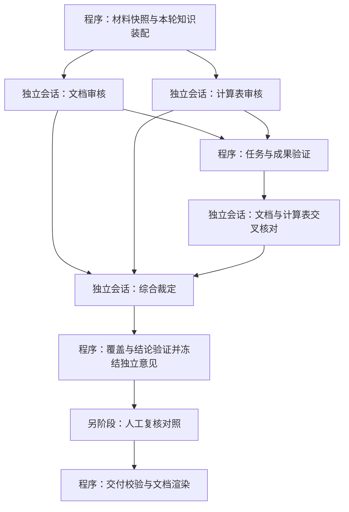

# 审核流程：独立会话与 LangGraph 编排设计草案

- 日期：2026-10-16（Asia/Shanghai）。
- 状态：根据本轮交流整理的待评审设计快照，尚未实施，不作为现行操作指令。
- 用户目标：文档审核、计算表审核、交叉核对和综合分析分别在独立会话执行，防止同一会话持续累积上下文影响审核质量。
- 关联：[估值流程设计草案](2026-10-16-valuation-isolated-session-graph-design.md)、[项目质量评估快照](../../analysis/2026-10-16-workflow-quality-github-review.md)。

## 1. 已明确的设计约束

1. 每个专业审核任务启动全新会话；不继承父会话或其他 Agent 的消息、工具记录及推理过程。
2. 调度器执行程序逻辑，维护任务依赖、状态和成果引用；专业判断由独立任务会话完成。
3. 并发不足时排队启动独立会话。无法保证会话隔离或工具权限时挂起受影响任务，不能切回父会话执行审核。
4. 下游以经过校验的结构化成果及证据为输入；全部成果必须纳入汇总完整性检查。
5. 长材料按章节、业务对象或检验项继续拆任务，并保留跨章节、跨表的全局检查。
6. 长期保留员工身份、材料范围、隐藏区隔离、本轮知识获取和两阶段独立审核的现有边界。

## 2. 四个业务节点

每个业务节点可以展开成多个独立任务。图中的综合节点只有在完整任务清单核对结束后才能启动；图上的连线不替代程序的汇合门禁。

| 节点 | 处理内容 | 成果要求 |
| --- | --- | --- |
| 文档审核 | 错别字、语言与术语、内部数字一致性、适用知识库检验项 | 原文位置、问题候选、关键事实、逐项检查记录和未核项 |
| 计算表审核 | 公式引用、计算范围、跨表依赖、漏行重复行、单位精度、适用检验项 | 原公式、输入与引用位置、计算回执、问题候选和未核项 |
| 交叉核对 | 同一对象与同一口径下的文档数字、计算表数字及结论比对 | 双方证据、单位与时点、差额、匹配依据和歧义 |
| 综合裁定 | 综合全部成果，合并同质问题、处理冲突、判断影响并提出修改建议 | 每条候选的最终去向、来源并集、裁定理由、剩余风险 |

数值运算由受控程序或计算引擎执行。Agent 判断公式和引用是否符合业务含义；公式算得通不能证明引用对象正确。隐藏区或不可用依赖不通过扩大读取权限解决。

## 3. 会话输入和成果合同

每个任务的输入包包含：项目和运行标识、任务标识、必要业务画像、材料与知识版本、允许访问的证据、待执行检验项、必需上游成果及输出合同。完整父会话历史不进入输入包。

沿用现有材料 manifest、route profile 和 AuditResult 的领域语义。新增任务与成果记录是执行事实，不成为第二份 Skill 或规则库存。

每个任务必须输出：

- 执行状态和输入版本；
- 已执行、不适用、未核、待确认的检查点及证据；
- 带对象、指标、单位、日期、口径和位置的关键事实；
- 有稳定 ID 的问题候选、规则来源、材料来源和计算回执；
- 能力缺口、冲突以及完整产物清单与指纹。

最终会话通过完整成果索引查阅证据。大量候选先分组裁定，再总审；原始候选仍全部保留。程序要求每条候选都有保留、合并、否决、转人工确认或未核等明确去向，合并必须保留全部来源。仅传递一段模型摘要不足以履行汇总合同。

## 4. LangGraph 与宿主边界

优先评估 LangGraph.js 作为应用编排适配器，通过宿主无关的会话执行接口启动 DSH 独立会话。该接口负责启动、状态查询、成果读取、取消及静止确认；DSH 身份、文件和工具操作仍由外层适配器负责。

根图状态只保存任务、依赖、状态、版本和成果引用，不维护共享专业审核消息历史。子任务会话及其必要的局部历史单独管理，数据访问仍受 Host 范围校验约束。LangGraph 的 state schema 不是授权边界。

正式接入前必须验证 DSH provider 能创建干净会话并回读工具权限。新的 session ID 或 provider 名称本身都不能证明未继承历史。验证失败时保留任务并报告能力缺口。

## 5. 冻结、恢复与验收

- 独立审核意见由可信执行边界计算摘要并冻结后，才能开放人工复核材料；人工复核历史不进入独立审核节点。
- 恢复按原任务和原输入版本回读已验证成果；启动结果未知时保留执行占用，确认静止后才允许换执行者。
- 知识、材料或上游成果变化时，重新执行受影响的下游任务并记录版本，不混用旧成果。
- 完整交付必须核对所有预期任务和所有候选；缺成果只能产生明确的部分结果或阻断，不能自动当作无问题。
- 验收包含会话历史隔离、无并发时串行独立会话、跨任务权限拒绝、计算与证据回读、候选去向完整、冻结后访问、重启恢复和取消行为。
- 最终效果通过固定案例比较误报、漏报、证据正确性和覆盖情况，不预设多 Agent 必然提高准确率。

## 6. 参考依据

LangGraph 的图调度、子图输入输出和持久化能力由作者文档支持；本草案的审核合同与隔离门禁是 CRWU 的设计要求：

- [Graph API：节点、状态、条件路由与动态派发](https://docs.langchain.com/oss/javascript/langgraph/graph-api)。
- [Subgraphs：为 Agent 保留私有消息历史并显式映射输入输出](https://docs.langchain.com/oss/javascript/langgraph/use-subgraphs)。
- [Persistence：检查点与持久化](https://docs.langchain.com/oss/javascript/langgraph/persistence)。
