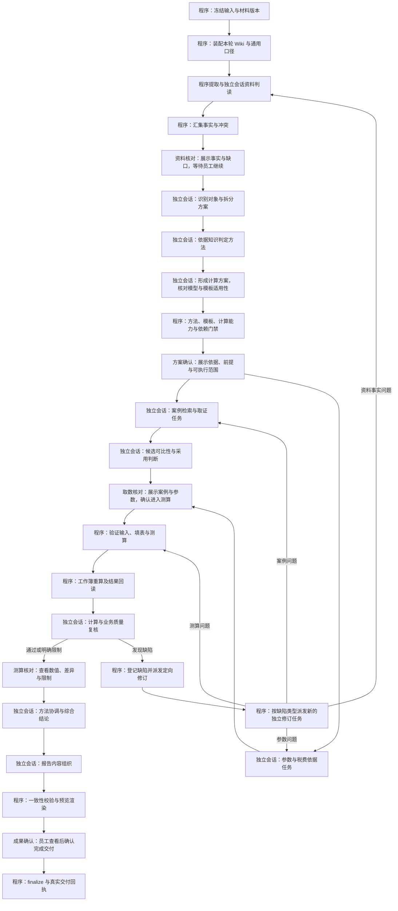

# 估值流程：阶段推进、可修订方案与独立会话设计草案

- 日期：2026-10-16（Asia/Shanghai）。
- 状态：待评审设计快照，尚未实施，不作为现行操作指令。
- 目标：员工输入文件及评估条件后，按可见的业务阶段逐步推进；以可修订的方案协调独立会话，控制上下文增长，并让每阶段结果、障碍和下一步都能核对。
- 本轮补充要求：以当前估值代码作为流程基线，筛选可使用的 GitHub 项目，并给出重新规划后的估值流程及组件落点。
- 最新产品方向：阶段推进是主交互。默认在业务大阶段交付后等待员工继续；方案描述当前已知条件下的路径，可以根据真实取数和测算结果修订，不要求开始时锁死全部执行细节。
- 前提：沿用[审核独立会话设计](2026-10-16-audit-isolated-session-graph-design.md)的干净上下文、结构化成果、汇总完整性与权限约束。
- 本轮范围：保存设计并核对源码；没有引入 LangGraph 依赖，没有修改生产代码、现行 Skill 或历史设计正文。

## 1. 当前基础与需要改变的地方

当前工作区已经有对象与方案模型、方法任务图、单执行租约、结构化知识工具、浏览器串行队列、检索预算、工作簿重算和真实交付校验。

相关源码入口：

- [任务图](../../../plugins/dsh-crwu-workbench/src/host/domains/report-evaluation/project/task-graph.ts#L1)：方案、方法任务、依赖和价值范围。
- [调度决策](../../../plugins/dsh-crwu-workbench/src/host/domains/report-evaluation/execution/decision.ts#L1)与[执行循环](../../../plugins/dsh-crwu-workbench/src/host/domains/report-evaluation/execution/dispatch.ts#L1)：当前允许由父会话顺序执行。
- [执行租约](../../../plugins/dsh-crwu-workbench/src/host/domains/report-evaluation/execution/leases.ts#L1)：启动未知时不允许重复接管。
- [方法能力](../../../plugins/dsh-crwu-workbench/src/host/domains/report-evaluation/project/coverage.ts#L1)：当前默认完整方法链路为市场法，收益法和成本法需按实际能力判断。
- [同 profile 串行队列](../../../plugins/dsh-crwu-workbench/src/host/domains/report-evaluation/browser/profile-queue.ts#L1)与[检索预算](../../../plugins/dsh-crwu-workbench/src/host/domains/report-evaluation/market/budget.ts#L1)：防止取证串页及重复搜索消耗失控。
- [完成校验](../../../plugins/dsh-crwu-workbench/src/host/domains/report-evaluation/delivery/finalize.ts#L1)：状态来自真实交付事实。

当前主要调整点：把“确认后交接给父会话执行到底”改为“在项目阶段视图中核对事实、确认方案、查看取数与测算结果，再推进下一阶段”。各阶段内部按职责派发独立会话；资源不足时独立会话串行排队，专业估值任务不回落到入口会话。

输入版本与执行方案分别管理：员工每次补资料或改关键条件形成新输入版本，已经确认的旧版本保留；方案在相应输入版本下形成修订版，记录变更原因、影响和确认决定。冻结快照不代表禁止后续补充，也不代表把尚未验证的执行路径永久锁定。

## 2. 三种实现方向

| 方向 | 优点 | 成本与适用判断 |
| --- | --- | --- |
| A：LangGraph.js 调度，DSH 独立会话执行 | 图依赖、汇合、恢复较清晰，保留既有工具与员工权限 | 推荐的设计方向；需验证 LangGraph 生命周期与 DSH 会话适配 |
| B：扩展现有调度器，全部改为独立会话 | 新依赖较少，复用现有任务图和租约 | 若 A 的兼容验证不成立，可重新评估；仍必须满足会话隔离 |
| C：LangGraph 直接调用模型 API 执行专业任务 | 可直接控制每次模型输入 | 涉及模型连接、工具执行和身份适配的新增边界，暂不作为第一版主路径 |

A 的依赖和兼容性验证未完成前，不宣称已接入。第一版优先跑通房地产市场法；图上预留其他方法的分支，但只有知识、模板、参数与计算能力均经过验证才执行。

## 3. 建议任务图



图中一个会话节点可以按材料、方案、方法或对象分组动态展开。程序负责检查预期任务全部到达明确终态，连线本身不能证明成果已经完整。

修订边仅表示下一版本的依赖关系，并按缺陷类型条件分流，不同时启动全部责任节点。每次修订生成新 attempt 与成果版本；相同缺陷、相同输入不能循环重做。达到项目执行预算或需要补充资料时挂起并给出具体动作。

关键前提失败时另进入“方案待调整”，展示证据与可行选项。用户确认新的方案版本后，从最早受影响阶段继续；未经影响分析和确认，不能直接沿原图继续，也不能悄悄切换估值方法。

## 4. 节点职责与成果

| 阶段 | 执行方式 | 输入 | 必须交付 |
| --- | --- | --- | --- |
| 输入冻结 | 程序 | 员工已确认输入、选定材料 | 原有输入快照、文件清单及摘要 |
| 资料识别 | 普通内容由程序提取，需语义或图像判读的材料进入独立会话 | 指定材料、必要通用口径 | 对象事实、原文或图像坐标、未识别页、冲突与缺口 |
| 方案划分 | 独立会话 | 完整事实索引、必要原文、冻结前提 | 对象归属、分组依据、权益与价值范围、待确认项 |
| 方法判定 | 每方案独立会话 | 方案、用户方法约束、本轮方法选择知识 | 采用与未采用方法、依据、冲突及所需能力 |
| 计算方案 | 每方案或方法独立会话，模板验证由程序完成 | 业务前提、适用规则、方法、候选模板及其合同 | 计算范围、必需输入、计算口径、模板匹配依据、结果位置和未验证前提 |
| 案例任务 | 每方案与样本用途独立会话，取数由受控工具完成 | 检索条件、渠道规则、原有预算 | 完整候选池、稳定案例身份、来源性质、详情证据 |
| 候选评估 | 与检索任务分开的独立会话 | 候选池、对象画像、可比性规则 | 逐条采用、相近、排除或未评估状态及理由 |
| 参数任务 | 每方案或方法独立会话 | 参数规则、资料事实、可用来源 | 每项取值、单位、时点、范围、依据与缺口 |
| 测算与重算 | 程序及受控计算能力 | 已验证参数、采用案例、验真模板 | 底稿、计算轨迹、公式与引用记录、重算回执 |
| 质量复核 | 新独立会话，程序提供计算事实 | 底稿与回执、原始证据、本轮规则 | 检验项状态、业务错误、数值差异、修订任务或未核项 |
| 综合结论 | 每方案或项目独立会话 | 全部方法成果、限制、复核结果 | 方法协调依据、对象结论、汇总范围与剩余不确定性 |
| 报告组织 | 新独立会话 | 通过验证的结果和完整成果目录 | 报告数据中的说明与依据，不另造数值 |
| 最终交付 | 程序 | 报告数据、底稿、截图、全部必要回执 | 一致的 HTML/JSON/工作簿和真实完成状态 |

资料识别会话不补写未读页面事实。用户未指定目的、价值类型或基准日时继续使用现有未指定声明与限制，节点不能自行补齐。

## 5. 独立会话是必需条件

每个任务使用独立 session，不继承父消息、兄弟消息、历史工具输出或前轮推理。相同项目身份和必要业务画像可以作为显式输入复用。

节点输入使用有版本的任务包：

```text
项目 / 运行 / 方案 / 方法 / 对象 / 任务标识
本任务职责与输出合同
材料、知识、模板的版本及允许引用范围
必需上游成果与相关业务前提
允许的结构化工具和产物写入范围
本轮资源预算、取消状态与人工动作
```

输入包由可信执行层组装。会话只能访问其任务需要的资料与产物，跨方案、跨案例调用继续由 Host 拒绝。LangGraph 中的消息私有化不替代这些授权检查。

同一任务需要继续局部工具调用时可以保留其短历史；达到任务上下文预算前，应由程序持有完整成果索引，按对象或检查项拆出新任务。没有证据的模型摘要不能成为新会话的唯一事实来源。

资源不足时降低并发、排队启动干净会话；provider 不支持干净会话或工具过滤不可验证时挂起受影响任务。不能用父会话继续估值作为恢复方式。

## 6. 结构化成果与全量参照

扩展现有项目索引、TaskNode、知识快照、候选台账、报告数据和完成回执。具体字段在实施设计中与现有 Schema 同步，不在本草案声明一套已经存在的新工具。

建议每个任务成果至少登记：

| 信息 | 用途 |
| --- | --- |
| 任务、会话、attempt、输入摘要和上游版本 | 确认谁基于哪一版输入执行 |
| 事实、参数和结论的稳定 ID | 支持按对象、指标与口径比对 |
| 材料、规则、模板与计算证据引用 | 回读原文、图像、单元格和重算结果 |
| 检验项执行状态与未核项 | 区分完成、未执行、不适用和能力不足 |
| 候选采用与问题处置记录 | 防止案例或问题在汇总中静默消失 |
| 产物清单及摘要 | 确认真实文件存在且未被替换 |

最终综合会话必须参照所有任务的成果登记和全部实质结论。程序检查完整性，大规模数据按对象与问题分组裁定，保留完整明细和证据读取能力；不能把全部历史对话拼成最终上下文。

执行失败的任务仍在索引中，以缺口和影响进入结果。报告组织 Agent 不得静默删除未核项或自行修改已验证金额；发现问题应派发修订任务。

## 7. 业务边界继续由知识和现有合同决定

- 本轮知识按入口 Wiki 与真实链接读取；业务阈值、渠道顺序、方法适用和参数含义不写成 LangGraph 常量。
- “业务适用”与“当前能执行”分别记录；图中的收益法、成本法或土地分支不代表相关能力已经上线。
- 对同一对象，多方法估值是不同方法结果，不能直接相加或无依据取平均。协调方法与权重必须有本轮知识依据。
- 汇总前核对对象身份和价值范围。房地合一价值不能再次叠加同一对象土地或建筑物价值；其他对象也不能因重复分组被重复计价。
- 挂牌、询价和成交保持原性质；是否能形成特定参考值由明确知识依据及现有边界决定。
- 关键参数缺失时挂起受影响计算，不能以零、经验值或相邻对象数据补足。
- 工作簿由验真模板生成，输入区和公式区按合同处理；缺重算回执仍按现有规则降低完成状态。

## 8. 并发、状态恢复与单写入者

LangGraph 只决定任务依赖与调度。并发许可、工具可见性、浏览器队列和文件写入仍由现有执行边界约束。

1. 每个任务同一时刻只有一个执行者；沿用租约和启动未知状态，确认静止后才允许更换。
2. 同一浏览器 profile 的导航与截图继续串行；不同 Agent 不得绕过队列直接抢占页面。
3. 检索预算绑定原有业务分组与轮次；切换 Agent、重试节点、恢复检查点都不能清零。
4. 各阶段成果分别写入任务范围内；方案最终底稿、报告数据和项目索引各由指定写入者提交，避免多个会话覆盖同一文件。
5. LangGraph 检查点与项目记录通过同一运行标识和成果版本关联。只保存可序列化的状态与成果引用，凭据和带鉴权 URL 不进入检查点、日志或提示词。
6. 节点重新运行前核对已有回执，不能假定失败就没有产生副作用。已完成取数或发布按原任务恢复，不重新提交整批。
7. 规则、模板、材料和上游事实变化后，计算依赖指纹并使受影响的下游成果失效；原版本保留追溯，未受影响成果可复用。
8. 使用新一轮知识形成的新估值应建立明确的新版本；恢复原运行不能静默读取今天的新知识替换旧依据。

父会话和 LangGraph 不同时保留两套权威业务调度。应用层的任务与依赖合同保持单一来源，LangGraph 从该合同构建执行关系；现有租约与完成校验负责各自的事实。

## 9. 阶段推进、可修订方案与员工体验

质量复核使用新会话，只提供任务所需证据、实际计算产物与规则，不继承估值执行者的聊天与推理。复核可以读取被检验的结果，但必须回到原证据判断，不能只认可前一 Agent 的解释。

缺陷按来源派回资料、案例、参数或测算阶段；新结果经程序验证后再进入复核。环境级失败暂停相应能力，避免串行重复失败。人工确认聚焦权益边界、关键资料冲突、用户方法约束冲突等真正影响结果的事项。

### 9.1 默认按业务大阶段推进

员工从现有入口提交资料后进入项目阶段视图。默认在下表的大阶段成果产生后暂停，核对或调整后点击继续；阶段内部的读取、解析、工具调用和已授权检索自动执行。

| 业务阶段 | 员工看到的成果 | 下一步主动作 |
| --- | --- | --- |
| 资料核对 | 识别对象、关键字段、原文位置、未识别页与冲突 | 确认资料，生成方案；或补充、更正资料 |
| 方案确认 | 对象分组、方法依据、计算范围、拟用底稿、必需参数、当前能力与待验证前提 | 确认本阶段方案，开始取数；或调整约束 |
| 取数核对 | 合格与相近案例、排除理由、参数来源、缺口与预算 | 依据已满足时进入测算；不足时选择处理路径 |
| 测算核对 | 重算结果、方法差异、复核发现、未核范围 | 核对后生成报告预览；或修订相关任务 |
| 成果确认 | 报告预览、底稿、证据与限制、真实交付范围 | 确认完成本轮交付；或提出具体修订 |

“确认”表示认可当前版本的事实或下一阶段执行范围，不要求员工保证未来一定能取到案例或完成全部方法。阶段成果未满足条件时，“继续”不能绕过必要门禁；可选择保存部分成果或补充资料等符合现有合同的路径。

后续可以增加员工明确选择的“在已确认约束内自动继续”，但关键输入变化、方法变化和不能成立的前提仍需停下来处理。首版不把自动执行到底作为默认。

### 9.2 方案确定方向，执行验证前提

方案包括已确认目标、当前事实、拟采用方法、必要资料、待验证前提、成功判据和有依据的备选路径。尚未取得的数据保持“待验证”，不能在确认方案时显示成已具备。

例如初步方案采用市场法，取数后发现可比案例不足：

1. 阶段状态变为“方案待调整”，保留已有材料、候选、排除理由和参数成果。
2. 展示实际缺口：缺哪些条件、已查过哪些允许来源、已消耗多少预算、受影响对象和方法。
3. 根据真实知识与部署能力给可用选项，例如补充成交资料、明确允许的新一轮检索、调整具备条件的方法、或交付当前阶段及未完成范围。不可执行的选项不伪装成可用。
4. 展示方案变更前后差异，以及需要重做和可复用的成果；等待员工选择。
5. 确认后形成新方案版本，只重新执行受影响阶段。切换方法不能只因原方法取数困难就认定业务上适用。

一般网络失败、单件解析失败及已确认规则内的替代渠道走既有有界恢复，不反复让员工批准相同技术动作；新增假设、权益边界或评估条件变化必须作为业务决定呈现。

### 9.3 一个可见工作面

项目视图持续显示当前阶段、已完成成果、待员工决定的事项和下一步动作。当前阶段展示业务结果摘要及证据入口，独立 Agent 会话作为可展开的执行详情。

阶段状态至少区分：未开始、排队、执行中、成果校验中、待核对、待补充、方案待调整、已完成、失败、取消处理中和已取消。状态来自 Host 的真实任务与回执，Client 不从文件存在、聊天措辞或时间流逝推断完成。

进展展示采用真实任务数和成果事实，例如“已读取 8/10 份资料，两份待确认”；总工作量不确定时不显示虚假百分比或未经测量的剩余时间。等待员工不是系统卡死，不进入无进展任务熔断。

在待核对阶段可查看已完成节点及其版本；修改上游内容前先看到影响范围。运行中可以请求暂停并补充信息，但要先停止派发、确认相关执行者静止，再提交输入或方案修订，不能边写旧结果边改新前提。

沿用现有 DSH 控件、主题和错误分类，提交与继续动作有明确的处理中、成功和失败反馈；状态不只靠颜色表达。交互指导取自 ui-ux-pro-max 的多步骤进展、明确反馈和错误恢复建议，不引入其通用营销页布局或独立配色。

这属于新的阶段运行界面及状态协议，超出现有“确认即交接”的启动页。LangGraph 提供执行与暂停能力，项目仍需实现阶段视图、决策表单、状态同步和断线恢复。

## 10. 首版范围与验收

第一版先验证“房地产市场法 + 单方案 + 干净任务会话 + 真实底稿重算 + 独立复核 + 项目交付”闭环，再扩展多对象、多方案和多方法。

这定义的是技术闭环的验证次序。员工有多对象、多方案资料时仍完整登记；尚未通过验收的分支明确说明能力状态，不能把输入中的其他对象静默丢弃。

必要验收：

- 在入口会话和某任务写入测试标记，确认其他任务初始模型输入不含这些历史；只有任务包明确允许的信息可以传递。
- 并发上限为一时，全部专业任务仍使用独立会话；不可创建干净会话时有明确阻断和恢复动作。
- 默认每个业务大阶段成果验证后等待员工继续；无有效决定时不启动下一阶段，等待期间不误判为任务失败。
- 取数不满足初步方案前提时展示方案修订及影响，已核实的无关成果保留；不能自动切方法或全项目重跑。
- 页面刷新或重启后回到真实当前阶段，仍能查看成果并回答原待决事项；旧版本按钮不能确认新版本方案。
- 稳定对象、面积、日期、单位与来源能在资料、参数、底稿和报告之间逐项追踪。
- 程序捕获错误公式引用、漏行、关键参数缺失、案例性质不符、重复计价、报告数字与重算结果不一致。
- 最终成果缺任一必需任务、候选处置或计算回执时，完成状态正确降级或阻断。
- 启动超时、插件重启、取消、节点重试均不会产生重复执行或覆盖其他任务产物；检索预算不重置。
- 适用知识、模板或对象事实变化后只恢复有依据可复用的成果，并重新执行受影响节点。
- 以相同脱敏案例对比当前流程，记录质量、总耗时、模型消耗、人工介入和恢复成本；不预先承诺提速或准确率百分比。
- 涉及外部执行能力的变更分别在 macOS 和 Windows 验证，记录实际平台和命令；能力缺失明确登记。

## 11. 接入顺序与待验证边界

实施前先以测试适配器验证 DSH 干净会话创建、工具可见性、会话归属、取消、成果回读及进程重启后的恢复。父会话只保留编排沟通功能的转变需要同步现有调度合同与测试。

然后接通任务包和成果验证，以及“资料核对 → 方案确认”的最小阶段界面；引入 LangGraph 的依赖执行、暂停恢复和持久检查点，再连接既有取数、计算和交付节点。会话隔离、可见阶段和任务成果验收是第一道条件，不能等最后增加。

本草案不指定未经验证的 LangGraph 版本或检查点后端。依赖选型要核对现有 Node/DSH 兼容、平台可用性和包分发；检查点必须具有所需持久化语义，不能用内存实现宣称重启恢复。

## 12. 作者文档依据

以下文档支持图调度、动态任务、私有消息历史和持久化的可行性。上述估值业务合同与 DSH 集成仍需要本项目自行实现和验证。

- [Workflows and agents：并行与 orchestrator-worker 模式](https://docs.langchain.com/oss/javascript/langgraph/workflows-agents)。
- [Graph API：状态、reducer 与 Send](https://docs.langchain.com/oss/javascript/langgraph/graph-api)。
- [Subgraphs：显式输入输出与私有消息历史](https://docs.langchain.com/oss/javascript/langgraph/use-subgraphs)。
- [Persistence：检查点与持久化](https://docs.langchain.com/oss/javascript/langgraph/persistence)。
- [Interrupts：等待外部输入、保存状态和恢复执行](https://docs.langchain.com/oss/javascript/langgraph/interrupts)。
- [Streaming：逐节点状态与事件输出](https://docs.langchain.com/oss/javascript/langgraph/streaming)。

## 13. GitHub 组件选型与采用顺序

下表是基于作者仓库和文档作出的选型建议，没有安装、部署或在本项目数据上做性能测试。适合某一能力不等于已经兼容当前 DSH 运行时。

| 项目 | 作者提供的能力 | 本项目落点 | 建议 |
| --- | --- | --- | --- |
| [LangGraph.js](https://github.com/langchain-ai/langgraphjs) | TypeScript 图编排、状态、条件路由、子图、检查点 | 任务依赖、独立会话的派发与汇合、运行恢复 | 第一版核心候选；先验证 DSH 会话适配，再固定兼容版本 |
| [Docling](https://github.com/docling-project/docling) | 多格式文档解析、版面与表格结构、OCR、统一文档表示；[来源位置](https://docling-project.github.io/docling/reference/docling_document/)可记录页码、区域与字符范围 | 复杂 PDF、扫描页、版面复杂表格的可选解析 provider | 用同一组脱敏材料与现有提取器对比；确认提升后按需接入 |
| [PaddleOCR](https://github.com/PaddlePaddle/PaddleOCR) | 图像和 PDF 的 OCR 与文档结构解析 | 权证、中文扫描件等图像证据的可选 OCR provider | 作为备选后端；按具体模型、运行后端和平台验证，不默认叠加全部模型 |
| [LibreOffice](https://github.com/LibreOffice/core) | Calc 表格引擎及[强制公式重算](https://help.libreoffice.org/latest/en-US/text/scalc/01/recalculate_hard.html?DbPAR=CALC) | 现有工作簿重算 provider 与结果回读 | 优先复用当前受控适配；以实际底稿证明公式兼容和重算结果 |
| [promptfoo](https://github.com/promptfoo/promptfoo) | 提示词、Agent 和模型评测、程序断言及 CI 集成 | 固定估值案例的回归与版本比较 | 第一版开发验证候选；通过自定义 provider 调用完整流程或对已产出结果评分 |
| [Langfuse](https://github.com/langfuse/langfuse) | 调用追踪、Agent 可观测性、评测与自部署 | 运行耗时、模型消耗、失败节点和质量反馈 | 第二阶段可选；先用本地任务回执采集必要指标，有团队观测需求再接 |

首版建议组合为 **LangGraph.js + 现有结构化工具与计算脚本 + 已验证重算 provider + 固定案例评测**。材料解析增强作为可替换 provider 接入，不因引入图编排而强制更换正常工作的解析路径。

Docling 和 PaddleOCR 的取舍以字段级测试决定：坐落、权属、用途、面积、金额、表格行列及来源位置是否正确。OCR 原始结果只是提取候选，重要数字和权属事实仍须能够回到原页核对。

LibreOffice 核心源码的 GitHub 仓库是只读镜像，本设计不要求从源码编译。当前配置式本地引擎与 DSH LibreOffice Kit 是不同 provider；Kit 如被选用，需要自己的探测、调用和回读适配，不能把它直接当作已有 `enginePath` 的等价替换。

`openpyxl`、现有 Decimal 计算脚本、模板填写合同和报告渲染继续承担各自职责：读写工作簿、运行受控公式业务、保护公式区域、生成最终文档。接入新组件前先证明当前哪项能力不足，以及新组件解决了哪项可复现问题。

Langfuse 如接入，应在应用侧先过滤数据再发送。作者文档提供[数据屏蔽方式](https://langfuse.com/self-hosting/security/data-masking)，其中服务端摄入屏蔽是企业功能；本设计不依赖该功能保护员工材料。首版观测只需任务标识、状态、版本、耗时、消耗和错误类别，原始材料、凭据、带鉴权 URL 与完整会话内容不自动上传。

## 14. 新流程相对当前流程的具体变化

| 当前运行方式 | 重新规划后的运行方式 | 对员工的意义 |
| --- | --- | --- |
| 父估值会话负责从识别到交付的完整业务过程 | 项目阶段视图呈现成果与决定，各专业阶段在独立会话执行 | 能核对每一步再继续，单项上下文范围清楚 |
| 资源不足时父会话顺序执行 | 干净任务会话串行排队，隔离能力不足则明确挂起 | 忙碌不会改变质量边界 |
| 现有任务图主要围绕方案、方法和组件 | 在相同项目身份下进一步显式表达资料、案例、参数、复核与交付依赖 | 能说明当前处于哪个业务阶段、还缺什么 |
| 一个会话连续完成候选整理和采用判断 | 检索证据与可比性评估分别交付，按完整候选池核验 | 候选排除与采用理由可以复查 |
| 测算、说明和结果组织在相同会话衔接 | 程序计算后，由新会话按原证据独立复核 | 错误不会只依赖计算者自己发现 |
| 模型最终组织各阶段信息 | 程序核对全部成果与候选去向，报告会话组织已验证结论 | 缺口与争议不会在汇总时消失 |

不会因这次重规划改变员工扫码身份、既有材料范围或知识库入口。需要改动的工具合同、状态字段和跨进程行为，实施时必须同步协议、Schema、测试、当前操作文档与变更记录。

## 15. 一个项目的运行示例

以下是流程示例，不是业务规则或真实估值结果：员工提交包含住宅与商铺的资料，并请求自动判断方法。

示例中的资料、方案、取数、测算和成果五个阶段，分别遵守 §9 的展示与等待规则；步骤编号是业务处理顺序，不表示点击启动后自动运行全部步骤。

1. 程序冻结输入、解析文档结构并登记页级覆盖；复杂材料按相关页送入干净的资料判读会话。
2. 方案会话根据原始事实与本轮知识给对象分组；不能只凭资料文件名把“公寓”当作某一用途。
3. 各方案的方法会话读取相应规则，分别说明采用方法和依据。若某方案需要的方法缺执行能力，记录该方案缺口，其他有依据的方案继续。
4. 可执行方案启动案例与参数任务。出售价格与租金分别建组；同一浏览器 profile 仍串行取证。
5. 案例评估会话给完整候选池逐项判定，保留所有排除、相近与未评估记录；参数会话为每项取值提供时点和口径。
6. 程序校验输入、填充验真模板、计算、强制重算并回读；缺关键输入挂起该计算，不填零凑完整。
7. 新的复核会话检查数值、公式依赖、依据、证据和报告口径；问题派回责任节点形成下一版本。
8. 综合结论会话参照住宅、商铺以及全部方法和复核成果。对缺能力的对象明确列出未完成范围；只有价值范围不重叠的对象才能按相应业务口径汇总。
9. 报告会话组织说明，程序绑定已验证数字、渲染报告与底稿链接，由 finalize 给出真实完成状态。

## 16. 评测与组件接入门禁

先保存当前流程对同一组脱敏项目的结果和运行记录，再与新流程比较。评测应同时包含：

| 测试组 | 必须能发现的问题 |
| --- | --- |
| 材料事实 | 扫描页漏读、面积误识别、权属与用途冲突、同名不同版本 |
| 业务判断 | 错误分组、用户指定方法冲突、适用知识遗漏、能力不足被冒充不适用 |
| 案例与参数 | 挂牌被当成交、重复候选、日期与税费口径不符、取值无依据 |
| 计算与结论 | 公式漏行、引用对象错误、单位与舍入错误、重复计价、方法结果被错误相加 |
| 成果汇总 | 节点失败被忽略、候选无处置、未核项消失、报告数字与底稿不一致 |
| 运行恢复 | 并发不足回落父会话、启动未知后重复执行、重启预算归零、取消误伤其他任务 |

结构、金额与证据绑定优先用程序断言；语义和业务合理性由独立标注及专业复核裁定。模型评分可以辅助筛选，不能独自充当业务真值。

组件试用需要记录固定版本、运行环境、输入样本、输出证据、耗时和失败类别。对 Docling、OCR 和重算 provider 分别在 macOS/Windows 验证；缺少某端证据时明确标记“仅已测平台验证”。如果引入新的外部执行依赖，应在同一实施变更内补充仓库要求的平台映射、能力探测和恢复路径。

最终是否采用额外解析或观测组件，以这些结果决定。LangGraph 解决编排和状态管理，业务精准度仍由材料质量、规则适用、可复算测算和完整质量门禁共同决定。

## 17. 阶段决定、方案版本与 LangGraph 的对应关系

LangGraph 提供机制，阶段交互由本项目实现：

| 产品行为 | 执行与状态合同 |
| --- | --- |
| 展示阶段进展 | Host 将节点事件转为业务阶段事实；Client 展示并在重连后回读权威快照 |
| 等待员工继续 | 必需成果验证后进入独立的决定节点，通过 `interrupt` 保存待决事项；没有决定就保持等待 |
| 员工补充或调整 | 提交带当前输入、方案和待决事项版本的业务表单；Host 校验身份、范围和新字段 |
| 恢复阶段 | 决定落盘后按原流程检查点恢复；每个专业任务仍使用独立 DSH 会话 |
| 方案需要改动 | 保存变更原因、前后差异、重做范围及复用清单；确认后发布新方案版本 |
| 旧页面或重复点击 | 决定按稳定标识去重，旧版本拒绝并要求刷新；重复请求不能派发第二组任务 |
| 修改正在执行的前提 | 先停止后续派发并确认受影响执行者静止，再生成新版本；旧成果不能覆盖新结果 |

方案版本建议具备草稿、已确认、待调整和已被替代等状态，并与已确认输入版本关联。阶段状态与方案状态分别表达“正在做什么”和“当前执行依据是否仍成立”，避免把一次案例不足直接显示成全项目失败。

决定节点与有副作用的专业任务节点分开。作者文档明确：从 interrupt 恢复时，所在节点会从开头重执行；因此启动会话、提交检索、生成底稿或发布文件不能依赖“暂停前只执行一次”的假设，必须通过既有租约和回执恢复。

资料核对到方案确认应作为第一条可体验链路：提交文件后先看到已读事实及缺口，再看到有依据且标明待验证前提的方案，然后选择进入取数。后续阶段沿用同样合同逐步接入，防止先完成后端全自动链路、最后才补阶段按钮。

## 18. 最终计算表由什么决定

计算表的决定链必须先于具体 Agent 派发：

```text
本次业务条件 + 经核对的对象事实
→ 匹配适用的准则、专业规范与本轮业务知识
→ 分析方法适用性及数据条件
→ 形成带待验证前提的计算方案
→ 选择并验证能够承载该方案的模板及填写合同
→ 取得案例、参数和取值证据
→ 更新计算方案并确认已满足必要条件
→ 填表、重算、交叉核对与独立复核
```

业务知识库应承载规则与模板的可追溯来源，包含适用条件、计算口径和检验要求；知识节点存在或模板能打开，都不能单独证明它适用于本次业务。内部模板也不能替代其应遵循的准则和专业判断。

### 18.1 六类决定依据

| 依据 | 需要明确什么 | 对最终计算表的影响 |
| --- | --- | --- |
| 本次业务条件 | 评估目的、价值类型、基准日、使用范围及实际适用的地区和监管条件 | 决定价值内涵、时点、适用要求及披露范围 |
| 对象及权益范围 | 对象身份、登记用途与实际状况、房地边界、权利限制、需单列的资产组成 | 决定计算单元、分组和汇总边界，防止漏项与重复计价 |
| 适用专业规则 | 本轮应采用的准则、方法规则、参数规则、案例条件与内部技术要求 | 决定可采用的方法、必需计算环节和检验项 |
| 方法与评估假设 | 方法适用依据、关键假设、业务允许的分析路径及结果协调依据 | 决定测算模型、公式链、所需明细与方法结果组织 |
| 核验后的数据与参数 | 用户资料、现场或专业核验资料、外部市场数据、案例、参数的时点和口径 | 决定输入值、修正、预测及结果是否有充分支撑 |
| 模板与填写合同 | 来源、版本、业务适用范围、输入/公式/结果区、单位、精度和回读位置 | 决定经确认的计算方案如何被正确表达为可复算工作簿 |

评估目的不直接一对一映射某一种方法；对象名称也不足以决定模板。方法选择需要结合目的、对象、价值类型和资料条件分析。软件当前能运行的方法是执行能力事实，不能反过来代替业务适用性判断。

上述专业框架与[财政部《资产评估基本准则》的政府转载正文](https://jcs.moa.gov.cn/ckzcgl/201904/t20190429_6287983.htm)所述业务基本事项、资料核查、方法适用性分析及工作底稿要求一致；具体项目仍须核对其实际适用版本和专业规则。本轮没有读取企业实时业务知识正文，不能据此宣称某一具体模板已经适用于某类业务。

### 18.2 区分结构决定与数值决定

底稿结构主要由计算范围、采用方法、适用规则和模板合同决定；底稿中的数值由原始事实、核验资料、案例、参数、假设和程序计算共同产生。两者通过版本化的计算方案关联。

例如同一商铺，若经适用性分析采用市场法，计算方案需要表达案例及其差异处理；若采用收益法，则需要表达收益、费用、期限及资本化或折现等适用模型内容。这里是计算需求示例，具体字段、公式和取值仍应来自本轮规则及验真模板，不能直接把示例固化成软件默认值。

### 18.3 方案确认应交付计算方案

在员工确认进入取数前，至少展示：

- 本次计算对象、价值内涵、基准日或未指定状态，以及对象分组与权益范围；
- 采用和未采用方法的依据、适用知识及具体版本；
- 每个方法需要哪些数据、案例、参数和关键假设，哪些已确认、哪些待验证；
- 拟用模板的来源、适用范围、填写合同、公式链及结论位置，程序验证结果与缺口；
- 对象结果、方法结果如何形成最终结论，哪些可以汇总、哪些不能相加；
- 取数后需要重新确认的条件及其失败时允许的处理路径。

这份方案既定义“最终要产出什么计算表”，也作为后续任务的验收依据。案例或参数未取得时，可以确认带明确前提的初步方案；关键口径未知时继续分析或准备，不能将假定口径冒充已确认业务条件。

### 18.4 选表与公式验证不能只停在技术结构

现有[知识读取合同](../../../plugins/dsh-crwu-workbench/skills/biz/crwu-biz-valuation-realestate/references/knowledge-routing.md#L1)要求业务正文来自本轮知识，参数与模板有出处；现有[工作簿合同](../../../plugins/dsh-crwu-workbench/skills/biz/crwu-biz-valuation-realestate/references/06-workbook-contract.md#L9)规定输入区、公式区和结果区由模板自己的描述文件声明。

在这些技术门禁之上，还需要验证模板能否表达本次价值范围、方法、单位、时点、税费口径、计算依赖和结果组织。通用结构检查通过，不足以证明业务模型正确。

如果有效计算方案没有匹配模板，应记录具体模板或适配能力缺口。依据明确但需要新模板的情况，应走显式模板制作与验证任务，经确认后才能投入本轮；不能由 Agent 为继续流程临时造公式、覆盖模板公式或取一份相似表硬套。
