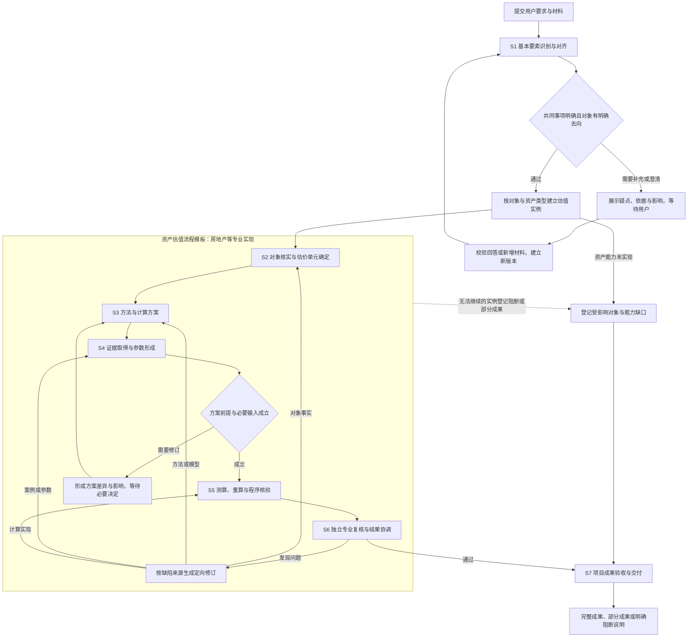
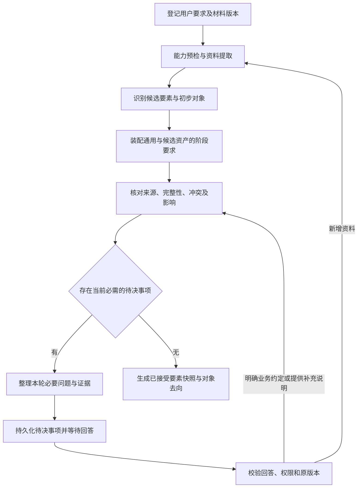
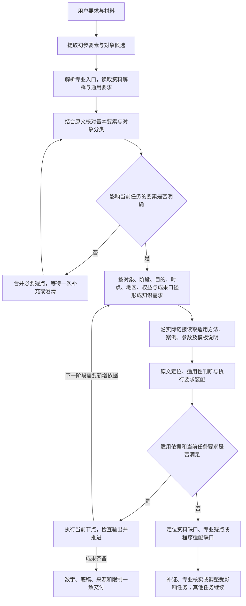

# 通用估值流程、基本要素对齐与房地产专业子图设计

> **历史快照**：本文是 2026-10-17 的设计记录，不作为现行操作指令；正文（含当时的"待评审 / 尚未实施"
> 表述）保持原样。当前实现说明见
> [`plugins/dsh-crwu-workbench/docs/valuation-workflow.md`](../../../plugins/dsh-crwu-workbench/docs/valuation-workflow.md)。

- 日期：2026-10-17（Asia/Shanghai）。
- 状态：待评审设计快照，尚未实施，不作为现行操作指令。
- 用户目标：将 LangGraph 内嵌工作台插件，提高估值流程可靠性和成果质量；通用估值流程由程序管理，房地产提供专业扩展。
- 已明确要求：第一阶段从用户输入和资料中识别估值基本要素；缺失或不明确的事项与用户对齐，再推进受影响的后续工作。
- 后续明确要求：展示每个业务节点的输入输出；员工可校正输入并确认，用新对话重新执行相应推理节点，重新验证或重做受影响的后续节点。
- 最新业务优先级：先交付已接受口径下可用的挂牌参考金额、底稿及来源，再提升准确性与可追溯性、减少无效执行和窗口干扰。用户补充的历史痛点是验收依据，不代表当前代码已全部修复。
- 本轮范围取舍：先跑通有知识依据的业务闭环；关机恢复专项暂缓，不作为首个业务切片的交付内容。知识路由、适用性判断和正文转执行要求见第 19 节。
- 本次交付：完整业务流程、阶段合同、澄清机制、专业子图、运行与质量合同、现有代码接入边界及验收设计。没有修改生产代码、安装依赖或实施运行时迁移。
- 关联历史：[2026-10-16 阶段推进与独立会话草案](2026-10-16-valuation-isolated-session-graph-design.md)。该草案正文保持原样；其中“默认每个大阶段暂停”尚未在本轮获得确认。本设计提出“校验通过自动推进，必要决定才等待”的待评审交互方案。

## 1. 范围与成功标准

流程从“用户提交估值要求与材料”开始，到“形成有依据、可复算、明确覆盖范围的估值结果及底稿”结束。承接业务、签订委托合同、现场调查的实际实施、正式报告审签及业务报备属于所在机构完整业务流程；本系统接收相关成果并检查必要依赖，不以自动读取材料替代这些活动。

成功标准：

1. 影响当前工作的基本事项不清楚时，系统能说明已知信息、具体疑点、影响范围和用户需要做的决定。
2. 全部材料、对象、方法任务与问题都有明确去向，无法处理的内容保留为未核或能力缺口。
3. 采用的事实、规则、参数、模板和数值结果能追溯到对应版本与来源。
4. 每个阶段以程序验证的成果作为继续条件，模型的完成声明只用于触发验收。
5. 补充资料、改变前提或发现错误后，只重做依赖发生变化的工作，并保留旧版本。
6. 超时、重复点击与取消不会导致同一任务被重复接管或旧成果覆盖新成果；关机恢复属于后续专项，首个业务切片不据此宣称支持重启续跑。
7. 对固定脱敏案例验证质量变化，不预先承诺估值准确率或提速比例。
8. 员工能从进度节点检查依据、校正输入、预览影响并启动新版本；新对话使用明确的上游成果，旧对话和成果可追溯。
9. 已确认挂牌参考时，有可用且可核对的挂牌依据、面积及计算条件就形成参考单价、总价、算法、来源、限制与底稿；正式成交数据、正式模板或其专属规则缺口不误伤参考交付。

本设计中的必填项和门禁是拟议的软件产品合同。具体项目的适用准则、方法、阈值及参数仍从实际适用的专业知识与业务依据取得。公开资料检索没有完成程序准则修订正文及适用时间的核实，本设计不对其作现行性结论。

## 2. 流程层次：公共模板与专业扩展

采用三个层次：

| 层次 | 职责 | 专业边界 |
| --- | --- | --- |
| 项目估值主图 | 基本要素对齐、对象完整登记、派发各资产估值实例、项目成果验收 | 理解通用估值合同，不解释房地产计算细节 |
| 资产估值流程模板 | 对象核实、方案、证据参数、测算、复核协调五个公共阶段及门禁 | 由资产类型提供专业阶段子图 |
| 方法阶段子图 | 为某个已选方法取得所需证据参数、执行计算并产生方法成果 | 方法适用性与执行能力分别验证 |

房地产估值图是按公共模板装配的专业实例。公共阶段顺序、成果登记、版本校验和完成规则复用；各专业子图可以增加检查与分支，不能自行放宽公共门禁。未来其他资产类型提供各自专业实现，未实现的类型登记缺口。

公共门禁必须按已确认的成果口径实例化。房地产流程至少区分正式估值与挂牌参考两条明确路径；参考路径使用自己的最小输入、算法、底稿及验收合同。参考交付不等待正式路径全部就绪。口径发生实质变更才重新确认，不能因更换会话、渠道失败或进入下一阶段反复询问。

公共流程属于程序服务，不新增包揽所有资产专业知识的总 Skill；资产 Skill 继续保持专业边界和自包含。

## 3. 完整主流程



图中的修订分支由缺陷类型选择；同一缺陷不能同时启动所有责任节点。需要修改共同业务条件时，回到 S1 的对应要素修订，而不是在下游改写原值。

每个资产实例按自己的依赖推进。一个对象等待资料时，其他不依赖该缺口的对象可以继续；共同事项未明确时，所有依赖它的实例等待。项目最终统一验收，不能只汇总先完成的实例。

## 4. 阶段成果与通过条件

| 阶段 | 必须形成的成果 | 继续条件 | 未通过时 |
| --- | --- | --- | --- |
| S1 基本要素对齐 | 材料覆盖记录、要素台账、初步对象清单、澄清决定、已接受要素快照 | 共同业务事项明确；每个对象可继续、待补充或不支持的去向明确 | 等待用户或挂起具体对象；允许继续资料整理 |
| S2 对象核实 | 稳定对象身份、估价单元、权利和价值范围、专业事实及核查记录 | 用于下一阶段的对象事实满足要求；无未解决的实质范围冲突 | 补证、专业核查、回到 S1 调整范围 |
| S3 方法与计算方案 | 方法适用分析、采用与未采用理由、模型、必需输入、模板匹配、待验证前提、能力事实 | 方案有依据；关键口径明确；下一阶段有可执行工作；必要方案变更已确认 | 等待决定或登记方法能力缺口 |
| S4 证据与参数 | 完整候选及处置、证据索引、参数台账、规则快照、输入充分性检查 | 当前方法必需证据与参数满足合同，模板及计算能力已验真 | 明确补充动作、修订方案或挂起该方法 |
| S5 按口径测算 | 工作簿、计算轨迹、结果回读、程序检查记录；正式公式链另需真实重算回执 | 满足当前路径的计算和证据合同；挂牌参考校核静态独立计算，正式公式链检查重算 | 定位具体输入或计算问题；按当前路径判定影响 |
| S6 复核与协调 | 独立专业检验记录、缺陷处置、方法差异分析、协调依据、逐对象结论 | 必需检查已执行；实质问题已解决；结论与限制相符 | 定向修订、补证或保留未完成状态 |
| S7 成果验收 | 对象及任务覆盖表、估值说明、报告数据、底稿及证据索引、交付回执 | 交付范围与输入相符，数字与已验收结果一致，各缺口显式披露 | 交付部分成果或阻断说明，不标正式完成 |

阶段通过不等于已核实所有资料真实。检查记录须明确完成的是提取核对、来源核对、专业核查还是用户业务约定。

挂牌参考沿用现有[专属输出合同](../../../plugins/dsh-crwu-workbench/skills/biz/crwu-biz-valuation-realestate/references/09-output-contract.md#挂牌参考交付listing-reference一次性)：原始挂牌单价算术平均，未修正、未折扣；产出 HTML、XLSX、报告数据及计算轨迹，业务状态保持 `partial`。界面同时表达“挂牌参考成果已交付”和“非正式评估结论”，不能将有金额、有底稿的参考成果显示成纯失败或空白阻断。

正式估值依赖的成交可比实例、已验收专业模板和公式重算仍保持各自要求。参考输入无任何可用依据，或面积、单位等无法确认时，不编造金额，列出具体缺口并请求必要补充。

## 5. S1：基本要素识别、澄清和复验

### 5.1 基本要素清单

以下是首版产品要素集合；具体必需证据和适用条件由版本化要求集补充。

| 要素 | 从哪里识别 | 不明确时如何处理 | 阻断范围 |
| --- | --- | --- | --- |
| 评估目的及对应经济事项 | 用户说明、委托材料等 | 摘要已知事项，请用户明确本次用途；专业建议附依据 | 依赖该目的的方法方案 |
| 评估对象与范围 | 用户选择、资产清单、权属或业务资料 | 核对包含和排除的对象、组成部分，保留全部初步对象 | 受影响对象；整体范围不明时为项目级 |
| 价值类型及价值前提 | 用户约定、委托材料、适用知识 | 提供有依据的候选含义；需由用户或相应专业人员明确 | 受影响方案 |
| 评估基准日 | 用户要求、委托材料等 | 展示候选日期及来源；材料日期与本次基准日分开 | 依赖该日期的方案与取数 |
| 权益主体与拟评权益边界 | 权属材料、用户说明 | 区分本次委估范围与有待核查的权属事实 | 受影响对象 |
| 成果用途、使用范围与使用人 | 用户要求、已有委托信息 | 明确本系统成果预期用途及必要限制 | 适用范围判断与最终交付 |
| 已知假设、限制及资料约束 | 用户说明、材料中明确披露的事项 | 逐项登记，涉及方法或价值内涵的事项在执行前明确 | 实际依赖该事项的工作 |
| 方法要求与成果形式 | 用户输入 | 区分自动分析与指定方法，保留约束；不适用时请求调整 | 受影响方法或交付任务 |

服务费用、付款方式等可由上游业务系统管理，不为了运行估值流程强迫用户重新填写。上游已经明确的事项通过有来源的引用导入。

S1 项目出口按已确认口径核对目的、对象范围、时点、成果用途和影响结论的已知前提。正式路径还需明确适用价值类型；挂牌参考明确观察或参考时点、原始报价性质、采用算法和使用限制，不把参考口径冒充正式价值类型，也不因正式路径专属事项缺失而阻断参考计算。对象权益边界须达到能够识别本次拟评权益的程度。详细面积口径、剩余权利期限等可在 S2 核实，但在依赖它们的任务之前仍须满足要求。

资产类型先依据用户输入和材料形成候选，再装配专业要素要求；类型不明或相互冲突时请求澄清，不自动归入房地产。未实现的资产类型仍保留在对象清单中，标明当前能力状态。

### 5.2 执行循环



用户提交的原始要求、材料和回答各自保留。规范化后的表述能回看原文，不能用规范化过程改变用户意图。

提取器负责文本、表格、图像及来源位置；专业任务识别候选含义；程序核对字段、格式、对象归属、版本和要求覆盖。模型无法自行把候选事实标成专业核验通过。

无文本层 PDF 进入逐页渲染和判读路径，保存已读页与未读页；格式或运行能力导致未读的材料登记为未核。一个文件读失败后可继续读取其他独立文件；确认是整类环境能力故障时停止同类任务。

### 5.3 分开记录发现、接受和验证

每个要素至少包含三组独立信息：

- 发现状态：存在、缺失、冲突、不可读；存在时保留候选值及各自出处。
- 处理状态：待处理、已接受、延期处理、不适用；延期必须绑定后续门禁，不适用必须有依据。
- 验证记录：用户业务约定、与原始材料核对、来源真实性核查、专业核查等，说明执行者、范围和证据。

用户确认可以明确“本次按哪个基准日估值”这类约定。面积、权属等证据性事实发生冲突时，用户回答作为有来源的补充陈述；是否足以用于测算仍由相应要求和证据检查决定，不能将点击确认记成权属核验。

不得用模型自报置信度替代证据与通过条件，不从今天、文件日期、旧报告结论或文件名自动补定本次基本事项。

### 5.4 问什么、何时问

只提出当前继续所需的疑点。同一轮相关事项组成一张澄清卡，已有明确答案的事项不重复询问。

每个问题展示：

1. 具体事项与影响的对象或方案。
2. 已经读到的值、来源位置和差异。
3. 需要用户决定或补充的内容，以及为什么影响继续。
4. 有依据时提供可选答案，并允许补充资料、自由说明或表示暂时无法提供。

系统区分业务决定与补证要求。例如“请指定本次基准日”可直接回答；“两份材料面积不同”应同时提供原页核对入口和所需补充资料。

回答必须经过语义和格式复验。无法回答时，保留待决事项并挂起依赖它的任务；用户可以保存当前成果或明确调整委估范围。范围变化形成新版本，原对象仍保留在覆盖记录中。

### 5.5 S1 出口

- 共同事项和当前进入 S2 的对象达到要求时，形成不可变要素快照并继续。
- 共同事项未明确时保持等待，只执行资料读取、整理等不依赖该决定的准备工作。
- 个别对象信息不足时，保留该对象及具体缺口，其他满足条件的对象可以继续。
- 所有对象均暂不能继续时，交付已整理事实及补充清单，不产出无依据的估值金额。

## 6. 房地产专业扩展

| 公共阶段 | 房地产子图的主要节点 | 特有检查 |
| --- | --- | --- |
| S1 专业要素补充 | 识别权证、资产表、租约等材料及初步房地对象 | 对象名称、证号、地址只能作为识别线索，冲突保持可见 |
| S2 对象核实 | 匹配权证与资产行、核对用途面积、整理权利限制、确定房地边界和估价单元 | 登记用途与业务分类分开；明确面积和权利口径，避免漏项与重复计价 |
| S3 方案 | 分析各方法适用性、形成模型与计算单元、匹配模板和填写合同 | 业务适用与技术可执行分别记录；模板技术结构通过仍需业务适用检查 |
| S4 依据 | 根据方法取得案例、租约经营或成本等证据，形成参数与规则记录 | 保留完整候选、交易性质、排除理由、参数时点与来源；缺口不能用经验值补齐 |
| S5 测算 | 调用相应受控计算、填表、重算、回读 | 公式区保护，输入及结果位置由模板合同确定，关键参数未知不能填零 |
| S6 复核协调 | 回查原始证据、核对方法结果、分析差异与协调依据 | 多方法结果分别保留；同一对象含土地价值不得再叠加同一土地价值 |

房地产专业图复用公共阶段和门禁。方法注册项分别提供证据参数子图与计算子图，在 S4、S5 按已确认方案装配；不会为每个方法重复跑整套项目流程。

市场法、收益法、成本法的所需输入、案例条件、公式、阈值和协调方法来自本轮适用知识；本设计不写固定数量、税率、修正限值或方法权重。

房地分别评估先核实各组成部分能否独立取值及实际执行能力，再建立依赖。土地和仅建筑物能力未实现时，阻断受影响任务，保留其他可执行成果。新增图分支不等于新增已验收能力。

## 7. S3 与 S4 的衔接：方案允许有待验证前提

S3 形成的是版本化计算方案，至少记录：

- 对象、估价单元、价值范围、业务要素版本与适用知识。
- 各方法采用和未采用的依据，以及用户方法要求的处理结果。
- 计算模型、所需案例和参数、拟用模板与填写合同。
- 已满足条件、取数后才能验证的前提、失败时允许的后续动作。
- 结果组织及协调需求、能力缺口、必要用户决定。

有合法工作可做时，S3 可进入 S4 核实资料和数据可得性；进入 S5 前必须完成模板、输入与执行能力的实际验真。当前能力清单中的默认声明不能代替本轮检查。

取数后方案前提不成立时，形成“原因—证据—差异—影响—可复用成果”的修订提案。系统可进行已授权范围内的资料补全；改变方法、价值范围、关键假设或用户约束，需要相应业务决定。决定被接受后发布新方案版本，再重新验证依赖。

## 8. 拟议数据合同

本节是新增合同设计，类型名和字段尚未存在于现行协议，实施时需要同步 Schema、Host/Client 类型及版本。

| 记录 | 必需内容 |
| --- | --- |
| `WorkflowRun` | 运行标识、员工与项目归属、图及 Schema 版本、业务要素版本、各资产实例、运行状态 |
| `ElementFact` | 字段、作用范围、候选与接受值、出处、发现状态、处理状态、验证记录及问题引用 |
| `RequirementSpec` | 适用对象与阶段、必需输入、允许的证据类别、校验规则、缺失影响、规则版本与来源 |
| `ObjectRegister` | 所有已识别对象的稳定 ID、材料行或页引用、归属、估价单元、继续或挂起状态 |
| `ClarificationRequest` | 稳定问题 ID、事项、影响范围、依据、问题、待答要求、原输入与要素版本 |
| `UserDecision` | 请求 ID、提交标识、回答与补充材料引用、预期版本、员工身份、验证及接受记录 |
| `StageReceipt` | 阶段与任务、输入依赖指纹、执行 attempt、预期成果、真实产物摘要、检查项和最终状态 |
| `MethodResult` | 对象与价值范围、方法、金额和单位或无金额原因、模型与参数版本、底稿回执、限制 |
| `Issue` | 问题来源、严重性、作用范围、阻断哪些任务、责任节点、处置依据、关闭证据 |
| `ArtifactRegister` | 产物标识、归属、相对位置、内容摘要、来源任务及成果版本 |
| `ProgressSnapshot` | 运行及方案版本、快照序号和更新时间、各对象阶段、当前活动、已验收任务、待决与阻断事项、阶段成果引用 |
| `NodeInvocation` | 业务节点与所属对象方案、运行修订版、输入输出合同版本、输入输出快照、依赖摘要、attempt、检查点定位、执行会话或程序回执 |
| `NodeCorrection` | 修订提交标识、源节点及原输入版本、字段差异、理由与证据、作用范围、影响分析版本、员工身份及接受记录 |
| `RunRevision` | 修订版标识、父版本及锚点、修订原因、有效输入、受影响节点、复用依据、当前采用状态与成果位置 |
| `ValuationModeDecision` | 正式或挂牌参考口径、适用对象与方案、已接受算法和限制、用户决定来源、有效输入版本、需要重新确认的变更条件 |

字段值可以为空，但空值始终保留其原因和影响；禁止用零、空数组或模型默认值表达“尚未知晓”。

初步对象清单、方案分组和最终对象结论之间必须能按稳定 ID 核对。材料行没有进入计算时，仍记录原因；不能通过删除对象让覆盖检查通过。

要求集采用“通用阶段要求 + 资产专业要求 + 已采用方法要求”的组合。各要求分别声明阻断阶段，避免所有字段在入口一次性必填，也防止延期字段在后续被遗忘。

## 9. 状态与推进规则

分开记录运行状态、节点验收状态和估值成果状态。

| 层次 | 状态与语义 |
| --- | --- |
| 运行 | 运行中、等待用户、暂停中、已暂停、停止中、已取消、已结束、系统失败 |
| 阶段任务 | 待执行、执行中、等待决定、验收通过、带允许限制通过、阻断、失败、已被新版本替代、取消 |
| 成果 | 沿用 `completed / partial / blocked / failed / cancelled` 的业务含义 |

多个对象可以处于不同阶段，因此项目状态包含各实例的阶段，不能用一个 `currentStage` 覆盖全部事实。有任务在运行时项目为运行中，同时展示待决事项；没有可继续任务但有待答问题时为等待用户。

`END` 代表本次图调用结束，业务完成状态仍取决于实际验收。有必需工作未完成时只能形成相符的部分成果或阻断说明。

成果交付状态与专业结论资格分开记录。挂牌参考四类产物验收通过后，可显示“参考成果已交付”，同时保持 `partial` 与参考限制；正式结论未就绪不抹去已经完成的参考交付。某一对象未完成时项目明确展示覆盖差异。

非关键缺口只有在对应要求明确允许的情况下才可带限制通过；关键证据缺失或金额无法核实时不能以一般限制声明绕过。

公共门禁检查输入版本、对象归属、必需成果及验收结果；专业校验检查模型、规则与证据含义。模型和用户界面均不能直接写入通过状态。

## 10. 员工交互

首版建议采用“验证通过自动推进，必要决定等待”的方式。项目总览始终可查看阶段成果和限制；不为每次读取或工具调用增加确认。

必须等待的事项包括：

- 当前工作必需的业务基本事项缺失或含义不明确。
- 资料事实冲突需要用户补证，或需要相应专业人员核查。
- 用户指定方法与实际适用性冲突。
- 委估范围、价值内涵、方法或关键假设需要实质变更。
- 外部验证等需要员工完成的动作。

工作台在现有“报告评估”模块内增加项目运行视图：阶段与对象概况、当前成果、待决事项及输入表单、证据和产物入口。员工可按对象查看已接受事实及未核事项。界面遵循现有 DSH 主题与交互合同，具体视觉实现不在本设计内展开。

提问和状态属于项目运行，聊天可作为入口，但不以聊天历史作为权威台账。用户在聊天里补充时，先转成可核对的候选决定，再通过同一业务校验入口接受。

回答请求带问题 ID 和预期版本；重复提交去重，旧页面提交拒绝并提示刷新。用户明确表达的决定不反复要求确认；新回答改变原范围时展示其实际影响。

### 10.1 当前估值进度

项目运行视图持续展示进度，作为首版功能的一部分，员工离开聊天或刷新页面后仍能查看。

| 展示层次 | 内容 | 判据 |
| --- | --- | --- |
| 项目概况 | 运行状态、各对象或方案状态计数、待处理事项数量、最后更新时间 | Host 权威快照；同时存在执行与等待时两者均可见 |
| 通用阶段 | 七个阶段、各阶段覆盖的对象数、验收与等待情况、可查看成果 | 按对象实例及其阶段回执汇总；有对象未完成时不将整个阶段标成全部完成 |
| 对象与方案 | 当前阶段、正在执行的业务动作、已验收任务、等待原因、最近成果 | 当前有效方案版本、真实任务状态与已验收回执 |
| 需要员工处理 | 疑点、影响范围、所需回答或材料、处理入口 | 尚未解决的有效待决事项；处理后保留处置记录 |
| 成果与运行记录 | 已接受的事实、阶段成果、限制及业务事件时间线 | 已登记的真实成果与经过筛选的业务事件 |

多对象项目分别展示各自所在阶段。例如一个对象正在重算、另一个等待面积补证时，项目显示“运行中，另有待处理事项”，两个对象各自保留真实状态。

进度优先表达业务阶段与验收事实。计划任务集合已明确时，可以展示“当前方案已验收 X/Y 项”；未确定总量时展示已验收数量和当前动作。阶段数量、模型输出长度和已耗时间均不换算成整体完成百分比，不预测没有依据的剩余时间。

发现新任务或方案修订时，展示版本变化、需重验范围及仍有效成果。原版本通过的任务不能直接计入新版本；复用成果须先通过依赖和版本检查。重新执行任务时标明修订处理中，不能为保持进度条增长而保留已失效的完成计数。

进度快照是应用服务记录的只读投影，客户端不另建调度状态机。业务事件携带运行标识、版本与递增序号，用于及时更新；事件缺失、断线重连或页面重新打开时回读权威快照，并去重或丢弃旧事件。

连接中断或状态长时间未更新时，界面展示连接状态与最后确认时间；是否失败由 Host 核对执行事实后决定，不能因为页面断线就判任务失败。长任务可以报告“正在重算”等活动状态，但阶段通过仍等待真实验收回执。状态带文字与图标，不仅依赖颜色。

### 10.2 点击节点查看输入、输出与修订

每个公开可操作的业务节点声明输入输出合同，并登记一次实际执行的输入输出快照。一个阶段可以包含多个这样的节点；尚未建立独立合同与恢复边界的内部步骤只展示活动状态，不提供虚假的单步重跑入口。

节点详情至少提供：

| 区域 | 展示内容与动作 |
| --- | --- |
| 本次输入 | 上游成果、用户约定、专业事实、规则与模板引用、任务约束及各自版本；标明可修订字段与来源 |
| 本次输出 | 结构化结论、依据及可复核分析说明、检查结果、缺口和实际产物；可打开关联执行对话 |
| 校正与重跑 | 修改输入或补充说明和证据、查看前后差异、预览影响，点击“确认修订并重新执行” |
| 版本记录 | 原始与历次修订输入输出、修改原因、验收结果和对应对话，可比较变化 |

可修订字段由业务合同和权限决定。原始材料、知识快照和验收回执保持不可变；需要更正时追加资料或选择新版本。用户可以表达对输出的异议，并将其作为新任务的修订要求；金额和检查状态仍由计算与验收形成。

### 10.3 修订、确认和新对话

交互顺序：

1. 员工选择某次节点执行，查看它实际使用的输入与输出。
2. 编辑允许修改的输入，补充修订理由或证据，保存修订草稿。
3. Host 校验字段、归属、原输入版本和必要证据，计算影响范围。
4. 界面展示修改差异、需要重做或重新验证的节点、可复用成果及必要的补证事项。
5. 员工确认后，系统停止受影响的后续派发并确认相关执行者静止，然后接受新运行修订版。
6. 需要专业推理的节点创建新 DSH 对话并重新执行；程序计算节点调用对应受控执行器。新成果通过原有验收后，按依赖推进后续工作。

本次确认包含所展示的修订及重跑范围。范围未变化时不再为同一决定反复询问；版本变化或校验发现更广影响时，原确认失效，须先展示新差异和影响。

新对话的任务包包括：本节点目标与成果合同、仍有效的上游结构化成果、修订后的输入、修订说明、必要原始证据与知识引用、允许的工具。前一节点的分析结论可以作为明确输入传入；其完整聊天历史不自动继承。

原节点的旧输出保留在版本记录中。只有员工明确要求比较或修正原判断时，才把有关旧结论与异议作为带来源的参考交给新任务，不能混入新输入冒充已确认事实。新对话可以在工作台打开，员工在其中的进一步修改仍经统一修订入口形成结构化决定。


## 11. 插件内嵌与执行边界

选择 LangGraph.js 在插件 Host 进程内运行。图定义和业务服务不依赖 Cordis 上下文或特定模型宿主，外层装配 DSH 执行器、文件、知识、计算和持久化能力。

拟议职责落点：

| 位置 | 职责 |
| --- | --- |
| `src/host/domains/report-evaluation/workflow/` | 公共阶段合同、要求、澄清、依赖和图装配 |
| `src/host/domains/report-evaluation/assets/realestate/` | 房地产阶段装配与专业校验，复用现有业务模块 |
| 现有 Host 应用装配与外层适配 | DSH 任务执行、权限、scope、运行库与受控存储 |
| `src/host/operations/report-evaluation/` | 业务启动、提交决定、状态快照、暂停继续及停止操作 |
| `src/shared/contracts/` 与 `src/shared/wire/` | 经过校验的业务输入输出及协议版本 |
| `src/client/modules/report-evaluation/` | 项目阶段、对象、待决事项和成果展示 |

首版复用 DSH 模型能力。专业节点通过任务执行器创建干净会话，只发送明确任务包；不继承父会话、兄弟会话或前轮推理。执行器返回结构化成果引用，应用服务验收后推进图。

LangGraph 子图本身不保证 DSH 会话隔离和工具权限，这些必须通过真实适配测试。资源不足时降低并发并排队；创建干净会话或工具过滤不可验证时挂起任务。

现有模型可见 Tool 与图节点共同调用经过授权的业务服务。逐步把 Tool 中的业务 I/O 抽到拥有明确输入、scope 与权限校验的服务；不在 Host 中伪造会话身份去调用 Tool，也不复制一套无权限检查的工具逻辑。

父会话不再持有独立的业务推进权。流程阶段、任务、决定与成果以应用服务记录为唯一来源，LangGraph 执行该合同，Client 展示其投影。

## 12. 检查点、澄清恢复与副作用（关机恢复专项暂缓）

本节保留此前讨论的候选技术方案，不作为本轮关机恢复的实施承诺；节点校正、新对话和运行中的等待仍需支持。若后续开展本地持久恢复专项，候选采用 SQLite 检查点及运行台账，先验证作者维护的 JS SQLite saver。数据库拟放在 Host 管理的本机持久数据目录；项目交付文件仍在选定工作空间的案例目录内。

这是一项待实施的技术选型，不代表现有 DSH 包已支持其本机依赖。后续专项先验证当前包声明覆盖的 Node/DSH、macOS/Windows 安装产物、权限和实际读写恢复。失败时报告运行时能力缺口并停止启用持久恢复能力，不把内存状态称为持久化，也不要求员工临时安装依赖；本轮业务切片不以这项候选依赖作为前置条件。

检查点只保存可序列化业务状态和成果引用。运行 ID 与 DSH 会话 ID 分开；凭据、令牌、带鉴权 URL、私有端点及原始秘密错误不进入图状态或日志。

澄清采用专门的 `interrupt()` 节点：业务问题已经持久化后等待，用户决定通过身份、范围、版本和语义校验并落盘后，再恢复同一运行。专业任务启动、检索提交、写底稿与发布文件分别在其他节点完成。

不假设图检查点和业务台账由官方 saver 自动原子提交。外部副作用采用“持久化动作意图 → 取得唯一执行资格 → 执行 → 回读事实 → 登记回执 → 推进”的顺序。恢复时核对动作意图、现有执行者和产物，再决定下一步。

动作去重标识绑定运行、任务及有效输入依赖指纹；attempt 单独记录每次实际尝试。任务启动结果未知时保留占用，确认原执行者静止前不再派发。既有租约需要从进程内状态扩展为可恢复记录。

检索预算与浏览器队列继续约束所有执行者；预算跨重试与重启保留。同一条件失败不循环重做，环境级故障熔断同类任务。现有挑战恢复专用策略保持自己的预算，通用重试不再叠加。

界面消费经过筛选的业务事件，并在连接恢复后读取权威快照。私有子图状态或原始事件不直接透传给 Client。

### 12.1 节点重跑的检查点与会话映射

LangGraph 的历史分支、业务运行修订版与 DSH 新对话分别登记，不能把三者当作同一个标识。运行修订版关联父版本和所选节点的调用标识；专业节点每个新 attempt 关联新会话 ID，停止和迟到成果按该关联核对。

每个允许校正重跑的业务节点建立“准备输入 → 执行 → 验收输出”的边界，并保存执行前检查点定位及实际输入快照。检查点定位包含运行线程、子图命名空间、检查点 ID 和业务调用身份，不能只记节点名称。

从执行前的历史位置建立状态分支，应用经校验的输入修订，再运行所选执行节点。状态更新须按实际写入节点语义处理；不能把所选执行节点标成已经完成，从而只执行它的后继。列表和消息等带 reducer 的状态也要按修订版本隔离，防止旧输出被追加进新成果。

房地产或方法子图需要提供所暴露节点粒度的检查点历史。父级检查点不能直接证明具备子图内部任意节点的回溯能力。实施时验证子图配置与恢复语义，并给每个资产实例和调用分配独立命名空间，防止多对象或重复调用混用内部状态。

首版每个项目只允许一个正在推进的当前修订版。确认修订后，新版本成为当前待验版本，原历史仍可查看；原版交付件标明所属版本，新版未验收前不展示为当前有效成果。继续原历史版本同样需要明确决定及依赖检查。

历史回放会重新触发后续节点及其中的模型或外部调用，因此仍必须执行第 12 节的租约、动作去重、预算和副作用核对。插件负责依赖失效与成果复用，不能将框架回放直接等同于最小范围重算。

## 13. 补资料、修订、停止与兼容

版本分别管理材料、基本要素、对象事实、知识、计算方案、参数、模板及成果，节点依赖保存具体版本与摘要。

| 变化 | 典型受影响工作 |
| --- | --- |
| 目的、价值类型、基准日或权益范围变化 | 重新核对相应对象、方法、证据参数、计算及结论 |
| 某对象面积得到更正 | 重验该对象分组与模型；重做依赖面积的计算、复核和汇总 |
| 新增案例或租约 | 重做相关采用判断、参数与计算，不重复提取无关材料 |
| 模板或公式合同变化 | 重验适用性并重做依赖它的计算与重算 |
| 取新版本知识 | 建立明确的新规则版本并分析影响；恢复旧运行不静默换依据 |

修订先计算影响并使旧下游成果失效，再派发新任务。未变化成果只有依赖和验收仍有效才可复用。旧 attempt 的迟到输出保留记录，不能发布为新版本成果。

节点输入区的修改分成三类处理：

- 任务局部约束或补充说明：重跑该节点，沿它的输出依赖确定后续影响。
- 共享业务事实或约定：向其拥有者提交有来源的更正，重新验证事实，并追踪所有使用者。例如在测算节点修改面积，可能需要先重新核对对象、分组或方案，实际起点可以早于所选节点。
- 知识、模板或其他不可变来源：通过新增证据或选择已验证的新版本修订，继续执行适用性和来源检查。

影响分析追踪明确登记的输入输出依赖。计划尚未明确或依赖精度不足时，保守地将相关后继列为需重新验证；不能声称已完成精确最小重跑。新节点输出产生后，按各使用者实际消费的字段及版本再次核对，仍有效的成果才可复用。条件分支改变时同步重建预期任务清单，保留被取消或替代任务的去向。

同一项目的新版本中不允许混用失效的旧结论。修订失败时，界面保留错误、旧版参考成果与恢复入口，当前版本保持相符的失败或阻断状态，不能自动把旧版结果回填为本次新结果。

运行中修改前提时，先停止后续派发、取消受影响执行者并确认静止，再接受新版本。停止图调用不等于已停止 DSH 会话、浏览器或计算引擎。未确认静止时保持停止中及租约占用。

图和 Schema 升级保存版本。旧运行只能由兼容实现或显式迁移恢复；不兼容时保留原成果并说明恢复动作，不自动重建运行冒充续跑。

## 14. 质量保证：规则、计算与复核

### 14.1 三类检查

| 检查 | 例子 | 通过依据 |
| --- | --- | --- |
| 结构及完整性 | 字段、单位、对象归属、预期任务、来源引用、产物摘要 | 受约束合同与程序检查 |
| 数值及计算 | 公式引用、舍入、修正规则、回读与报告数字一致性 | 已绑定规则、受控计算与真实重算 |
| 专业判断 | 方法适用、证据可比性、假设、模型适当性与方法协调 | 原始证据、适用知识与有依据的专业复核 |

普通正文和表格可以成为业务依据，数值执行前由程序侧适配成经验证的类型化参数，无需业务维护者额外编写专用 JSON。参数必须绑定真实原文、适用条件、单位和必要的专业复核；Schema 通过及摘要相符都不能单独证明提取正确。现有解析器缺少适配时登记程序适配缺口，不允许模型临时补阈值或改写指纹；拟议适配流程见第 19 节。

计算结果按对象、方法、价值范围和单位登记。报告金额直接读取已验收结果，说明文本可以由模型组织。模板、参数、底稿和报告之间需要可追踪的字段映射。

### 14.2 独立复核

估值内部的专业质量复核作为完成条件；它读取必要原始证据、实际计算与规则，使用新上下文，不接收执行者的历史推理。程序先完成可确定检查，专业任务重点检查判断依据和实质差异。

复核输出逐项检验状态、缺陷、影响与责任节点。复核模型不直接改最终金额；需要修改时生成修订任务。数值检查通过不等于专业判断正确，两个层次分别验收。

这与现有可选审核 Skill 的调用边界分开：估值内部复核属于本流程；额外审核仍可在成果形成后按原合同调用，也不冒充机构法定审签。

### 14.3 固定案例验收

使用脱敏且经专业人员标定的案例，至少覆盖：

1. 基本事项清楚，可自动进入对象核实。
2. 基准日、价值类型或范围缺失，正确提出必要问题。
3. 多个日期、多份面积或权益范围冲突，不能静默取第一个值。
4. 用户无法补充，正确挂起依赖任务且不重复追问相同问题。
5. 扫描件、旧 Office、部分页不可读，已读与未核覆盖准确。
6. 多对象中的局部缺口，其他对象继续，项目总范围保留。
7. 案例性质不符、参数缺依据、模板不匹配、重算缺失，正确阻断或降级。
8. 重复计价、公式错误、报告数字不一致，无法通过验收。
9. 多方法差异需要分析，不能直接相加或无依据平均。
10. 旧版本决定、重复提交、启动超时、取消和迟到结果；进程重启相关验证在后续恢复专项实施时完成。
11. 多对象进度、任务执行中与已验收的区别、等待用户、方案修订、事件乱序及断线恢复；进度展示与真实成果状态一致。
12. 点击专业子节点校正输入，所选执行节点确实在新对话运行；新对话不继承旧聊天历史，原输入输出保留可查。
13. 修改共享事实后，所有实际使用者被重验；需要更早核对分组或方案时能够扩大起点，无关对象成果正确复用。
14. 子图内部检查点、并行命名空间、节点更新语义及带 reducer 状态，不能跳过所选节点或混入旧结果。
15. 修订确认前后版本变化、重复点击、旧分支迟到输出及外部副作用恢复，不产生重复执行或新旧成果混用。

记录关键字段提取正确性、错误通过与错误阻断、依据完整性、数值及勾稽差异、必要澄清次数、恢复重复动作、耗时与模型消耗。程序确定的数值按适用精度比较；专业判断按标定依据评测，不用模型自评分替代验收。

涉及新外部执行能力与本机依赖的实现必须分别在 macOS 和 Windows 验证实际产物。文档阶段没有执行这些平台测试，也不声明跨平台已就绪。

## 15. 现有代码衔接与设计实施切片

现有基础：

- [输入、对象与方案合同](../../../plugins/dsh-crwu-workbench/src/shared/contracts/valuation-project.ts)：复用稳定对象及价值范围，扩展要素、澄清、版本与阶段回执。
- [材料提取](../../../plugins/dsh-crwu-workbench/src/host/domains/report-evaluation/intake/extract.ts)：保留能力与覆盖记录，作为 S1 的读取通道。
- [方法任务图](../../../plugins/dsh-crwu-workbench/src/host/domains/report-evaluation/project/task-graph.ts)：保留方法依赖和价值范围检查，纳入公共阶段合同。
- [调度 Tool](../../../plugins/dsh-crwu-workbench/src/host/tools/report-evaluation/execution.ts)：当前允许父会话执行，并接受完成任务清单；默认完成推断只检查部分文件非空。新流程以验收回执及原版本为依据，推进权交给应用服务。
- [租约](../../../plugins/dsh-crwu-workbench/src/host/domains/report-evaluation/execution/leases.ts)：当前为内存 Map，保留启动未知语义；持久恢复随后续专项验证，不冒充当前能力。
- [结构化规则](../../../plugins/dsh-crwu-workbench/src/host/domains/report-evaluation/knowledge/rules.ts)和[完成判定](../../../plugins/dsh-crwu-workbench/src/host/domains/report-evaluation/delivery/finalize.ts)：复用其来源约束与真实完成要求。
- [现行房地产流程合同](../../../plugins/dsh-crwu-workbench/skills/biz/crwu-biz-valuation-realestate/references/workflow.md)：保持现有模板、计算、土地及平台能力缺口；图改造不抹去限制。

行为迁移须明确：当前冻结输入允许某些基本事项未指定，交接后由父会话执行；新流程允许导入不完整初始材料，但在相关阶段门禁前补齐并建立不可变新版本。不能原地改写原冻结输入，也不能把现有旧运行自动当成新图运行。

建议分三次可验收的实施切片：

| 切片 | 完成范围 | 主要验收 |
| --- | --- | --- |
| 挂牌参考交付闭环 | 最小要素对齐、真实业务 Wiki 路由、适用依据与执行要求、对象核对、已有或新增候选池、已确认参考算法、四类产物及来源验收；进度与节点输入输出随链路接入 | 从真实资料和适用知识交付单价、总价、算法、底稿和证据；普通正文不被 JSON 格式阻断，口径不重复确认，修订可追溯 |
| 单方案估值闭环 | S2–S7、房地产市场法专业节点、模板与计算验收 | 从已接受要素到真实计算、独立复核及一致交付 |
| 多对象与多方法 | 动态实例、局部阻断、方案修订、跨方法协调 | 对象不遗漏，依赖可追踪，修订范围正确 |

切片未覆盖的对象依然登记，不能静默丢弃。每次迁移同步业务合同、Tool 可见性、Host/Client 协议、Schema、文档与测试；发布动作另按仓库规则授权。

## 16. 贯穿示例

以下只是流程示例，面积与日期用于演示，不构成专业参数或估值结论。

用户提交两套房的资产表、权证和一份旧报告，并说明本次用于转让。资料中出现旧报告日期和新清单日期，但未明确本次基准日与价值类型；A 房面积有两种数值，B 房资料一致。

1. S1 记录用户已明确的用途，不重复询问；区分两份材料的日期角色，提出本次基准日与价值类型的必要问题，同时展示 A 房面积冲突。
2. 用户明确本次基准日及价值类型。系统接受业务约定，生成新要素快照；A 房补充说明若仍不足以解决事实冲突，保持待补证。
3. B 房进入 S2。A 房仍在对象清单里，并标明为什么不能进入依赖面积的工作。
4. B 房完成对象核实后，S3 依据本轮知识分析方法，明确待验证前提，选择能承载模型的模板候选。
5. S4 取得候选案例及参数，对全部候选留处置记录。必要证据不足时展示补充或方案修订路径，不自动把参考信息当成交证据。
6. 按当前确认口径进入 S5：正式路径需完成其模板、规则与重算验收；用户已确认挂牌参考且具备有效输入时，按专属静态计算链交付参考单价、总价及底稿。正式模板缺口只限制正式路径，不反复阻断参考交付。
7. A 房补齐有效证据后，仅重新验证受影响要素及其后续任务，B 房有效成果继续保留。
8. 最终成果列出 A、B 两个对象各自状态；某对象未完成时，项目状态和说明如实表达覆盖范围。

## 17. 作者资料与核实范围

以下作者资料支持技术机制，不能替代本项目业务合同及实际兼容验收：

- [LangGraph.js 概览](https://docs.langchain.com/oss/javascript/langgraph/overview)：图运行时可组合确定性步骤与模型步骤。
- [子图](https://docs.langchain.com/oss/javascript/langgraph/use-subgraphs)：支持按输入输出合同组合父图与专业子图。
- [Graph API](https://docs.langchain.com/oss/javascript/langgraph/graph-api)：状态、条件路由与动态派发。
- [中断与恢复](https://docs.langchain.com/oss/javascript/langgraph/interrupts)：等待输入和恢复，所在节点从头执行的副作用约束。
- [历史回放与状态分支](https://docs.langchain.com/oss/javascript/langgraph/use-time-travel)：历史检查点、修改状态后继续、节点写入语义与子图内部回溯配置。
- [持久化](https://docs.langchain.com/oss/javascript/langgraph/persistence)：运行检查点与长期存储职责。
- [SQLite saver 作者源码](https://github.com/langchain-ai/langgraphjs/blob/main/libs/checkpoint-sqlite/src/index.ts)：本地后端候选，含本机依赖，需验证插件分发与平台兼容。

本设计没有读取本轮企业业务知识正文，没有对特定案例确定适用方法、业务阈值、模板或金额。专业执行时继续经受控知识工具取得与本轮绑定的依据。

## 18. 用户提供的痛点与验收映射

用户补充的历史事实包括：归档首轮约 14 分 16 秒、139 次工具调用、市场搜索为 0 次，以及后续长会话中任务未完成、初始测试与真实文件复核不一致。这些数据按用户报告登记，当前设计工作没有重新审计原会话，也不将下表视为已修复清单。

| 痛点 | 设计上的处理位置 | 必须验证的结果 |
| --- | --- | --- |
| 1. 操作很多却没有金额与底稿 | 口径分支、S3–S7、首个实施切片 | 已接受挂牌参考且存在有效依据时，实际交付单价、总价、算法、来源、限制与参考底稿 |
| 2. 真正检索前耗时过长 | 初始化能力快照、任务包与运行观测 | 必要门禁后尽早取得可用案例；记录首次检索、首次有效报价、首次参考交付的耗时及工具调用构成 |
| 3. 明确事实仍反复确认 | S1/S2、原始用途与专业分类分离 | 保留“公寓”原文；分类由证据与规则支持，不要求用户改成住宅来适应工具 |
| 4. 已接受选择失效 | `ValuationModeDecision`、跨节点和会话任务包 | 挂牌参考选择在有效范围内持续生效，只在实质条件改变时提出新的必要决定 |
| 5. Wiki 存在却被适配器阻断 | 知识来源与规则适配分别记录 | 按真实 Wiki 链接读正文附件；明确区分节点缺失、权限失败与结构化解析能力缺口 |
| 6. 下载与可计算性混在一起 | 下载回执、模板分层验证、路径去重 | 分别说明字节取得、格式结构、业务适用、公式及重算状态；已有有效文件复用，不循环下载 |
| 7. 重复读取与索引丢失 | 持久知识快照、产物索引、动作回执 | 已验真成果可按原版本恢复；汇总索引可从持久记录重建，失败不抹去已成功项 |
| 8. 列表没有形成可复用数据集 | S4 候选池与页面记录 | 每页一次采集形成完整结构化条目和来源定位；筛选读取本轮合并数据集，只为缺项补取详情 |
| 9. 挂牌与成交口径混淆 | 案例性质、用途、处置与模式门禁 | 挂牌观察、询价和正式成交分别登记；参考分支可使用合格挂牌，正式方法保持相应证据要求 |
| 10. 一渠道失败被扩大结论 | 逐来源状态与检索覆盖台账 | 验证码只记为该渠道障碍；保留其他来源结果，未查证渠道不写成整体无数据 |
| 11. 结果难以回查截图网址 | 稳定案例 ID 与交付引用、S6/S7 | 从 HTML 和工作簿定位实际网址、可点击链接、截图及对象；检查内容和定位有效性，不只检查指纹 |
| 12. 普通浏览抢前台 | 共享浏览器 profile 队列及人工介入入口 | 普通采集尽量后台且不主动抢焦点，确需登录或验证时提示并展示窗口；按实际平台验证，不承诺完全无窗口 |
| 13. 方案权限和收尾接线不一致 | 方案与 scope 先登记、验收回执、收尾去重 | 创建结果与执行范围一致；缺产物时返回生产节点修复，同输入且无新成果不重复 finalize 或生成阻断报告 |
| 14. 公式与业务检查偏差 | 专业模型、独立算术、工作簿回读与规则对照 | 发现循环引用、单位和引用错误；用独立标定案例核对单项及综合检查，脚本退出码不能代替准确性验收 |

### 18.1 已完成成果与失败恢复

知识正文及附件按本轮已验证身份、内容摘要和来源版本复用；需要取得新版本时重新核实，不能将未验真的旧副本冒充实时知识。结构化规则适配缺口只影响使用该规则的计算任务，不把已经读到的正文描述成不存在。

下载后的原始 Excel 可以作为真实附件保留；能下载、能打开、能用于本次业务和能正确计算分别验收。正式模板存在公式缺陷时，保留缺陷及修复任务。已确认的挂牌参考走专属静态底稿与输出合同，不把有缺陷的模板硬套进参考链。

每个来源独立保存列表页、合并候选、价格性质及采集证据。恢复时按稳定案例身份合并已成功项，候选采用与排除记录不会因后一次取数覆盖而丢失。来源解析器未能识别明确在售记录时，登记适配问题及原始证据，不能统一吞成业务上的“未知且不可用”。

成果收口前明确预期四类参考产物与其真实内容。生产失败进入有定位的修复任务；没有输入、产物或环境条件变化时，不反复运行相同收尾。旧版本已形成的成果只按其原版本展示，不能与新输入混用。

### 18.2 改进过程本身的验收

专业任务按明确目标、材料范围、必要成果、预算和恢复线索拆成有界任务包。长会话拆分后由程序排队与汇合，不将正常的继续执行交回用户反复催办。每个任务使用必要上下文，新任务从持久成果继续，不要求重新组织全部历史。

模型完成声明、初始单测和文件指纹各有作用，最终验收仍需打开或解析实际交付文件，核对对象字段、数值、公式、超链接与截图位置。至少使用同一组脱敏项目做端到端回放，记录质量、调用量、重复动作和恢复成本，区分离线通过、平台实测及线上未核范围。

原型中的案例、金额、文件预览和新对话均为示例交互。交互可点击不等于真实知识、浏览器、计算引擎或交付链路已经完成接入与验收。

## 19. 先跑通业务：知识取得、适用与执行约束

### 19.1 首个切片的业务边界

先以一个房地产对象、已确认挂牌参考口径跑通真实资料到真实成果的完整链路。首轮必须实际读取适用知识、取得或复用可核对案例、形成输入、计算并检查四类交付物；不能用模拟金额、假文件、模型自报完成或反复生成阻断报告代替验收。正式市场法和其他方法后续沿同一知识合同扩展。

知识属于每个阶段的输入，S1 就要使用资料解释和基本要素要求，不能等选好方法才第一次读知识。资产类型尚未确定时先做材料提取和候选识别；涉及分类疑点时澄清具体对象，不凭文件类型把整个项目转为房地产。资产入口登记只保存专业类型与受控知识入口的对应关系，不内置专业阈值。

以下为待实施设计。代码核对已确认现有入口与读取工具，但本轮没有连接企业知识库实读正文，不能据此宣称远端节点、现行内容和挂牌参考适用条款已经验真。

### 19.2 已有知识通道与明确边界

复用[知识路由合同](../../../plugins/dsh-crwu-workbench/skills/biz/crwu-biz-valuation-realestate/references/knowledge-routing.md)、[知识读取 Tool](../../../plugins/dsh-crwu-workbench/src/host/tools/report-evaluation/knowledge.ts)、[节点解析服务](../../../plugins/dsh-crwu-workbench/src/host/domains/report-evaluation/knowledge/resolve.ts)和[库内链接解析](../../../plugins/dsh-crwu-workbench/src/host/domains/report-evaluation/knowledge/wiki-links.ts)。房地产入口来自技能自身声明，设计示例为：

```text
知识库：中瑞世联业务知识库
入口：01 估值与测算/01 房地产/wiki.adoc
工具：crwu_valuation_knowledge_materialize
```

Host 使用当前员工的受控访问通道解析精确知识库身份、节点和正文；图服务调用具有相同权限检查的应用服务。Client 只提交业务输入与展示结果，不持有知识库凭据。通用资产流程通过资产注册项取得入口，房地产声明不复制成另一套全局常量。

首读向已有 Tool 提交 Host 认可的 `caseDir` 与入口 `wikiPaths`，有登记方案时再带 `planId`。随后根据返回的 `entries[].links[]` 选择下一跳：

- `kind=knowledge` 使用已按当前文档目录解析的 `path` 作为下一次 `wikiPaths`，保留原始 `target` 与锚点用于追溯。不能直接把未经目录解析的相对 `target` 当知识库根路径。
- 原文链接的 `.md` 与真实节点的 `.adoc` 由节点解析服务核对身份；调用方不猜后缀、不改名、不在同名结果中挑第一份。
- `external`、`anchor`、`invalid` 分别按外部参考、本文位置和非法链接处理。外部参考如需使用，必须通过受控外部来源通道核对，不能直接成为已验证库内规则。
- 走 `wikiPaths` 主通道；旧 manifest 无法读取时记录遗留通道状态，不阻断已经可读的真实入口和正文。不发明当前 Tool 不支持的 `stage` 值。

首版不引入向量数据库。已有 Wiki 作为专业导航；确需查找时，仅在已验证业务库和相应专业范围内做有界补充查找，结果作为待验证候选，不能取代缺失的权威入口或直接成为计算规则。

### 19.3 按业务条件逐步装配知识



`KnowledgeNeed` 是拟议的知识请求合同，至少绑定项目、对象、当前阶段、已接受事实版本、资产分类、原始用途、成果口径、目的、地区、相关时点、权益范围及候选或已选方法。尚未明确的字段保持未知，不先填猜测值来命中路由。基准日、市场数据观察日与规则施行时间分别记录，具体适用关系由原文和专业判断决定。

每一跳记录来源条款、条件、采用或未采用理由，以及下一份知识的实际身份。模型可解释自然语言条件并提出候选路由；程序核对来源、输入版本、节点身份与支持的分支。分类或条件存在实质歧义时形成明确待决项，不以模型置信度代替依据。

根据入口和已读正文区分当前分支必读、条件触发和参考链接，记录已读、未读及不适用的处置。计算前检查本分支必要知识和要求的覆盖情况，不能通过不读取相关章节来绕过约束；尚未读全登记为覆盖未完成。

| 业务位置 | 按需取得的知识 | 形成的执行约束 |
| --- | --- | --- |
| S1 要素对齐 | 输入资料解释、基本业务要求、对象识别依据 | 哪些字段从什么材料识别、当前任务缺什么、应问谁 |
| S2 对象核实 | 用途、权利、面积、估价单元及价值范围的相关要求 | 保留原始记载，登记分类依据、核查要求与冲突 |
| S3 方法方案 | 方法适用条件、限制、成果性质和必要假设 | 候选方法、采用理由、不能采用的理由、待验证前提 |
| S4 案例与参数 | 取数渠道、案例性质、可比性、参数依据及相关时点 | 候选处置、必需证据、参数单位与出处；不硬编码数量或折扣 |
| S5 测算 | 已选模型、算法说明、适用参数、模板填写与取整要求 | 受控计算器、类型化输入、单位与取整；按口径区分重算要求 |
| S6–S7 复核交付 | 适用检查、结果协调、披露与使用限制 | 必查项、逐对象覆盖、数字一致性和来源展示 |

不是所有行都对应新增远端读取。已取得的同版本正文按来源和内容摘要复用；后续只补本任务尚未覆盖的知识。链接去重、已访问集合和执行预算防止循环遍历；技术预算耗尽记为检索未完成，不能认定知识库没有相关规则。

本轮采用的内容绑定明确版本或实际内容摘要。新一轮使用旧快照前重新核对来源身份、当前访问权限和远端版本；来源不提供版本信息时如实登记，并按需重读正文确认内容，不能用本地修改时间推断远端未更新。缓存不继承其他员工的访问资格。

### 19.4 业务依据、项目事实和软件算法分别负责什么

| 输入类别 | 可以决定什么 | 不能替代什么 |
| --- | --- | --- |
| 已验证业务知识正文、表格及其适用依据 | 专业条件、方法和案例要求、参数依据、模板说明及限制 | 不能证明本项目材料所述事实已经真实核实 |
| 项目材料与用户有效决定 | 本次目的、范围、时点、成果口径及有材料支持的对象事实 | 用户接受挂牌参考不意味着可以豁免专业强制要求或编造缺失参数 |
| 市场案例及外部数据 | 原始报价、成交或经营等证据 | 案例页面不能自行规定选法、折扣或专业阈值 |
| 受控软件计算合同 | 已选择算法的确定运算、字段映射、校验与产物生成 | 脚本存在不证明该算法适用于当前对象，也不构成专业权威来源 |

以“公寓 + 已确认挂牌参考”为例，保留权证原始用途，根据实际知识判断对象、案例性质和成果限制。确认原始报价与面积口径、样本采用理由后，使用现有专属合同的原始挂牌单价算术平均，再据面积形成参考总价，不自行加入成交折扣或修正。算术运算不要求业务库重复描述每一步软件实现，但适用分析和专业限制必须有依据。

不得把“知识库没有专用 JSON”或“缺正式市场法修正阈值”当作参考分支的共同阻断条件。也不得凭“未查到禁止”推断允许；实际知识对该对象、案例使用或成果用途存在冲突或实质疑义时，登记具体条款和需要专业核实的事项。该疑点与用户已经接受参考口径是两件不同的事，不重复询问原决定。

### 19.5 正文与表格转为可执行要求

新增程序侧适配环节，输入为已验真知识快照和本次事实，输出为待验证的要求候选。维护者继续维护普通业务正文和表格；结构化文件由系统生成。每条候选应包含：

| 字段组 | 最小内容 |
| --- | --- |
| 来源 | 实际库与节点身份、路径、来源版本或更新时间（若提供）、读取时间、快照摘要、章节或表格位置、采用原文及其上下文位置 |
| 含义 | 规则或要求标识、原文要求、强制或建议性质、例外、条件和未解决疑点 |
| 适用 | 对象、阶段、方法、成果口径、地区、相关日期和权益等条件；本轮命中理由与所用事实版本 |
| 数值 | 参数值、单位、百分比表达、区间边界、取整要求与证据；原文未给出保持未知 |
| 执行 | 已登记计算器或检查器的参数位置、依赖项、未满足的影响和需要的补充动作 |
| 验证 | 来源定位校验、类型与单位校验、语义复核结论、必要人工专业核实和最终采用状态 |

处理顺序：

1. **提取候选**：模型从正文与表格定位要求，不生成新业务阈值；数值保留原表示和单位。表格保留表头、行列关系与脚注，扫描附件同时保留页码和可复核图像。
2. **验证来源**：Host 从已保存的真实内容重新核对原文位置、摘要和节点身份。片段摘要只代表片段；文件摘要相同并不能证明抽出的数值或含义正确。
3. **验证适用性与语义**：检查强制与建议、例外、日期、地域、对象和方法条件。独立专业复核输入真实上下文，不能只审核提取后的 JSON；模型间一致也不等于专业验证通过。自动判断无法消除的实质疑义交由具备相应专业能力的人核实。
4. **形成受控输入**：数值通过类型、单位、区间和必要精度检查后，由 Host 绑定来源与采用决定。参数来源、换算关系和本轮事实版本一起登记，调用方不能任意填摘要表示验真。
5. **执行已支持运算**：公式或文字算法映射到已有、经验证的计算器与数据参数。知识中的代码、命令、网址或模型生成表达式不能变成任意执行权限；新算法不能映射时登记计算适配缺口并开发验证。

一组执行要求允许引用多份已验证正文，每条保留自己的来源与适用条件；不要求所有规则预先汇入某一份 JSON 或共用一个文档摘要。同一要求出现不同候选值时先消歧，禁止合并时按最后一条覆盖。

专业条款存在冲突时先查明适用范围、效力、时间及正文自己的引用关系；没有充分依据时不按读取先后、文档名称或模型偏好选择一条。普通业务用户可补充资料和业务决定；专业规则争议进入专业核实，不把“点击确认”当作取消强制要求。

首版只实现挂牌参考链实际需要的要素、样本、算法和限制要求适配，不预先开发通用规则编译器。正式市场法所需规则随下一切片补齐。

### 19.6 三份业务记录与节点页面

拟议业务记录如下，均按对象和有效输入版本关联，凭据与带鉴权地址不得写入：

- **知识适用清单**：需要什么、实际读到什么、何处采用、为何适用、尚缺什么；引用已有 `知识快照/.知识来源.json`，不再复制一套正文来源系统。
- **执行要求**：本节点必需事实、证据、参数、算法、检查与输出合同，每项引用相应条款或软件合同，区分强制要求和建议。
- **检查回执**：每项要求的实际输入、检查结果、输出引用和未通过原因，供下一节点及交付验收使用。

用户点开节点可检查“采用知识”页签：显示真实文档与章节、采用原文、当前对象为何适用、参数取值与单位，以及满足或未满足情况。报告和底稿的知识引用须能反查到同一条记录，不能只放来源 hash。

用户校正资料或用途时，先生成差异，再重验依赖该事实的知识适用性和后续结果；必要的推理节点使用新对话。用户选择另一知识版本时先核实来源及适用性并展示影响，不直接覆盖旧快照，也不允许在界面直接编辑专业规则变成“已验证”。运行中的知识版本保持明确；主动更新依据时建立新的适用分析，不静默替换。

### 19.7 失败要分清影响和恢复动作

| 现象 | 业务处理与下一步 |
| --- | --- |
| 入口身份不符、入口缺失或无读取权限 | 暂停依赖该入口的专业执行，保留已读资料；分别请求确认正确入口、修复访问权限或处理系统故障，不猜其他库替代 |
| 某篇方法文档缺失、空白或同名歧义 | 精确标明节点与影响的方法；分别补正文、核实路径或由有权人员消歧，其他有依据任务继续 |
| 正文可读但缺 JSON 段 | 进入正文适配流程；当前部署尚无该能力时报告程序适配缺口，不要求维护者重写业务知识 |
| 原文本身缺少当前计算必需参数 | 指明缺哪个参数、影响哪个任务、需要什么来源或专业核实；不填默认值或借另一地区数值 |
| 专业依据明确但尚无对应计算器 | 分析和已取得证据保留，受影响计算待适配验证；不改用一个业务上不适用的方法凑数 |
| 正式模板或成交渠道不可用，参考链仍满足自身条件 | 保留正式缺口；按已经接受的参考合同继续实际交付，不反复请求同一选择 |
| 同一条件失败且没有新事实 | 停止同条件调用；只有输入、通道或环境变化时才进入有依据的恢复动作 |

### 19.8 现有代码接线与首轮验收

保留现有知识读取、快照、模板与挂牌参考工具，在应用服务中串成“取依据 → 判断适用 → 形成要求 → 获取案例 → 计算 → 验收”的确定依赖。图负责调度这些服务，Skill 提供专业任务说明，模型在限定任务包中分析，不由模型自行认定流程已通过。

实施前明确修正两处已从代码核对的契约不一致：其一，[旧规则解析器](../../../plugins/dsh-crwu-workbench/src/host/domains/report-evaluation/knowledge/rules.ts)仍含“必须先由业务维护者补齐结构化段”的错误文案，与知识路由合同冲突；其二，部分 Tool 说明让调用者继续使用 `links[].target`，而[链接类型](../../../plugins/dsh-crwu-workbench/src/host/domains/report-evaluation/knowledge/wiki-links.ts)明确 `target` 是原始相对目标，`path` 才是解析后库内路径。行为、说明和测试必须一起对齐，不能只改提示词。

首轮固定案例验收至少包括：

1. 真实入口能按身份核对并读取，沿真实链接取得必要正文，报告可反查采用的原文与位置；测试替身通过不能代替员工授权下的真实来源验收。
2. 普通段落和带表头、脚注的表格均能形成正确要求；缺 JSON 不被报告成缺知识。百分比、区间、否定、例外及日期条件错读时无法通过对应检查。
3. 原始用途“公寓”保持，已确认参考口径持续有效；案例采用与排除理由、面积口径、来源时间和原始报价可核对。
4. 使用已有可核对案例或实际获取的新案例，真正形成参考单价、总价及四类文件；正式路径专属缺口不误伤参考链，金额独立复算一致。
5. 文档里确实没有当前必需依据、规则适用冲突、错误库身份或无权限时，正确指出局部问题和可执行动作；普通用户确认不能绕过专业要求。
6. 重新进入节点不无故重读同版本知识；校正相关事实后重验实际依赖，旧参数不能混入新结果。
7. 实际打开交付 HTML 与 XLSX，检查对象信息、金额、限制、网址和截图对应关系，知识来源能定位到实际内容；不以文件非空、指纹相等或脚本成功代替交付验收。

涉及业务能力与数值正确性的测试及员工真实案例验收通过后，才认定首个业务闭环跑通。关机恢复、全资产扩展和通用规则引擎不加入本次首轮验收范围。
# 用户校正：图层级与结构化意图

2026-10-17 实施期间，用户明确要求图采用可注册、可组合的目录层级：`src/host/graph/graph.ts → graph/valuation/graph.ts → graph/valuation/realestate/graph.ts`。以下早期领域目录建议以本条校正为准，业务门禁、知识与验收要求继续适用。

估值图依据用户要求和已核对的文件正文识别意图；无文字输入时仍应读取文件内容，不能只看扩展名或默认房地产。DS 只接收明确输入并输出结构化意图或节点结果，程序校验结果、查注册表并推进图。意图不明确、与资料冲突或专业图尚未注册时，输出待确认项或明确能力缺口。房地产图必须作为真实编译子图注册并嵌入估值图，不能只移动目录或用导入开关模拟组合。
